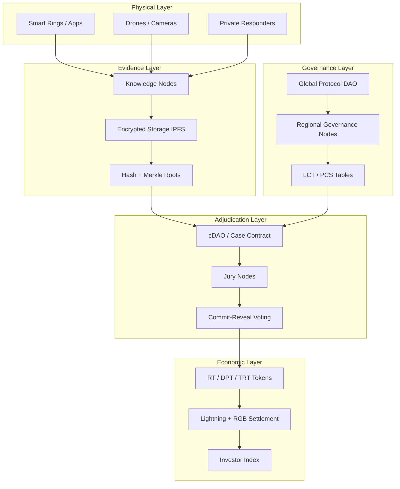
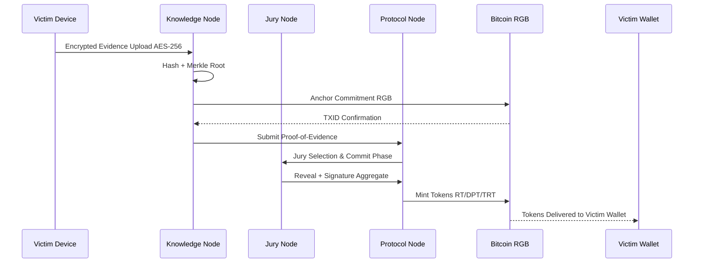
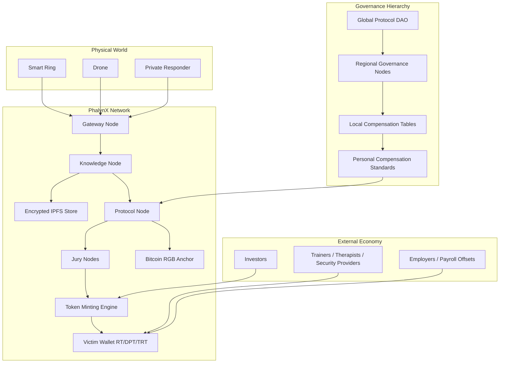

<!--
Source: https://phalynx.network/docs/architecture
Extracted: 2026-11-24 (America/New_York) from the public PhalynX Network site.
The site JS bundle was last-modified 2026-08-30 (HTTP Last-Modified on https://phalynx.network/assets/index-DQnlPCMO.js).
This file is a faithful Markdown conversion of the published page. Mermaid diagrams
were restored from the site source bundle. No protocol content was invented.
-->

# System Architecture

How PhalynX connects devices, juries, investors, and Bitcoin into a unified decentralized justice protocol.

> **Multi-Layer Architecture**
>
> PhalynX is a multi-layer decentralized justice protocol that connects human events to verifiable outcomes using a combination of devices, juror consensus, and Bitcoin settlement. It merges hardware evidence, software logic, and economic enforcement into a single composable ecosystem.

## Layered Design



## Layer-by-Layer Breakdown

### Layer 1 – Physical Input Layer

Interfaces the real world with the protocol.

| Component | Function |
| --- | --- |
| Smart Ring / App | Sends SOS alerts, GPS, and live evidence feed |
| Drones & Cameras | Autonomous or manual recording; optional bounty system |
| Responders / Threat Mgmt | On-the-ground verification, aid, and enforcement |

All physical devices use authenticated BLE or encrypted network links to submit data through a Gateway Node → Knowledge Node.

### Layer 2 – Evidence & Attestation Layer

| Element | Function |
| --- | --- |
| Knowledge Nodes (K) | Validate, encrypt, and hash incoming data |
| IPFS / Distributed Storage | Store encrypted media (video, audio, logs) |
| Bitcoin Anchoring | Commit Merkle roots via RGB/OP\_RETURN for immutability |

Each K-node signs an **Integrity Attestation** proving it received and hashed the data unchanged. Multiple attestations form a **Proof-of-Evidence packet**.

### Layer 3 – Adjudication Layer (Consensus)

| Element | Function |
| --- | --- |
| Micro-DAO (cDAO) | Smart contract instance for one case |
| Jury Nodes (J) | Randomly selected, bonded peers |
| Commit-Reveal Protocol | Jurors vote privately, then reveal with proof |
| Confidence Weighting | Verdicts weighted by juror reputation and consistency |

**Outputs:**

* Verdict (guilty/not guilty + confidence %)
* Claim value (C)
* Restitution ratios (RT / DPT / TRT)
* Bond adjustments (VB recalculated by outcome)

### Layer 4 – Economic Layer (Settlement)

The PhalynX economic layer converts moral outcomes into economic settlements using Bitcoin.

| Token | Description | Nature |
| --- | --- | --- |
| RT | Represents owed value to victim; transferable; redeemable in BTC | Liquid |
| DPT | Funds safety training, equipment, or protection services | Non-transferable |
| TRT | Funds therapy, rehabilitation, or recovery travel | Non-transferable |

All tokens are RGB assets anchored to Bitcoin and redeemed via Lightning invoices. Investors can fund operations (O-costs) and buy RTs for discounted recovery, creating liquidity and capital rotation.

> See the [Tokens](tokens.md) page for detailed token mechanics and the [Economics](economics.md) page for settlement payout ordering and bond formulas.

### Layer 5 – Governance Layer (Control & Adaptation)

| Level | Function |
| --- | --- |
| Global Protocol DAO | Defines protocol rules, RGB schema, and upgrade logic |
| Regional Governance Nodes (RGNs) | Maintain Local Compensation Tables (LCTs) |
| Pilot / Local Communities | Adjust harm multipliers and DPT/TRT allocations |
| Personal Compensation Standards (PCS) | Individuals declare their own restitution baseline |

Governance updates propagate downward as signed parameter deltas anchored to Bitcoin every epoch.

> See the [Governance](governance.md) page for detailed information on the multi-tiered governance system.

## Node Architecture

| Node Type | Role | Core Security |
| --- | --- | --- |
| Gateway Node (GW) | Accepts input from apps/rings; performs signature validation | TLS + Ephemeral Session Keys |
| Knowledge Node (K) | Hashes & anchors data; manages encrypted IPFS storage | Staked Attestation + Redundancy |
| Protocol Node (P) | Executes verdict contracts, mints tokens | Multi-sig + Slashing |
| Jury Node (J) | Performs voting via commit-reveal | Reputation-weighted anonymity |
| Governance Node (G) | Manages parameter updates | Multisig + Audit Anchoring |

All nodes are stateless where possible, with deterministic rehydration from anchored data.

## Data Flow Overview



## Cross-Layer Integration

| Function | Layer(s) Involved | Mechanism |
| --- | --- | --- |
| Bond Scaling (VB) | Adjudication + Economic + Governance | Formula uses RI + LCT + PCS |
| Token Minting | Adjudication + Economic | Verdict triggers RGB contract |
| Training / Recovery Redemption | Economic + Evidence | Provider proof → Knowledge Node |
| Local Value Calibration | Governance | LCT and PCS integration |
| Security Anchoring | Evidence + Governance | Bitcoin commitments every 10 min |

## Physical-to-Digital Bridge

### Smart Ring Integration

* Sends SOS signal via Bluetooth Low Energy (BLE) → phone → Gateway Node
* Captures timestamp, GPS, and haptic event log (proof of distress)
* Auto-triggers Evidence Session until user cancels

```typescript
// Smart ring SOS protocol
interface SOSEvent {
  ringId: string;
  timestamp: number;
  gps: {
    latitude: number;
    longitude: number;
    accuracy: number;
  };
  hapticLog: HapticEvent[];  // Pressure, duration, pattern
  battery: number;
  sessionId: string;
}

interface HapticEvent {
  timestamp: number;
  pressure: number;      // 0-100
  duration: number;      // milliseconds
  pattern: 'tap' | 'hold' | 'double-tap' | 'emergency';
}

// Auto-trigger evidence collection
async function handleSOSEvent(event: SOSEvent): Promise<void> {
  // Create evidence session
  const session = await createEvidenceSession({
    victimDevice: event.ringId,
    triggeredBy: 'sos',
    location: event.gps,
    timestamp: event.timestamp
  });

  // Route through Gateway Node
  await submitToGateway(session, event);

  // Continue until cancelled or battery depleted
  while (event.battery > 5 && !session.cancelled) {
    await collectEvidence(session);
  }
}
```

### Drone & Device Oracles

* Autonomous "Justice Drones" can record incidents on bounty basis
* Drones submit footage with geo-tag & signed telemetry to Knowledge Nodes
* Investors can fund drone coverage in high-risk zones; payouts tied to footage usefulness

This ensures independent, third-party evidence and transparency even when victims can't record.

## Interoperability & Extensibility

PhalynX architecture is modular:

* **API Layer:** REST & GraphQL endpoints for developers
* **SDKs:** for Android/iOS (smart ring apps), Node.js, and Python
* **Web3 Bridges:** optional hooks to Ethereum or sidechains for analytics or visualization (no settlement reliance)
* **Federation Protocol:** allows multiple local nodes to sync with the main Bitcoin anchor chain while maintaining autonomy

## Resilience & Fault Tolerance

| Failure | Mitigation |
| --- | --- |
| Node offline | Redundant Knowledge Node attestations across 5+ geographic zones |
| Data corruption | Merkle hash mismatch halts process; automated integrity alerts |
| Juror dropout (pre-reveal) | Dynamic reselection algorithm maintains minimum quorum; bonds slashed for unjustified dropout |
| Juror collusion | Stake-weighted slashing; reputation reset to 0; random rotation prevents coordination |
| Invalid node attestation | Stake burned; node reputation permanently marked; quorum re-validation triggered |
| Investor default / liquidity gap | Replacement by next available in pool; RT secondary market ensures continuous liquidity |
| Chain congestion | RGB commitments batched and retried with exponential backoff |
| Smart contract bug | Formal verification pre-deployment; emergency pause via node quorum (>2/3) |

All system-critical actions are **idempotent** — retries cannot alter prior state.

## Summary Diagram



## Design Philosophy

> **Truth → Value → Recovery → Prevention**
>
> PhalynX is designed to form a closed-loop justice economy:
>
> 1. **Truth** is captured and verified by evidence (Layer 1-2)
> 2. **Value** is calculated through decentralized adjudication (Layer 3)
> 3. **Recovery** is executed via BTC-denominated tokens (Layer 4)
> 4. **Prevention** is enabled through training and trauma healing (Layer 4-5)
> 5. **Governance** evolves by feedback from data and outcomes (Layer 5)
>
> **The result:** A self-sustaining, self-correcting justice protocol where human dignity is collateralized and protected by cryptographic integrity.
