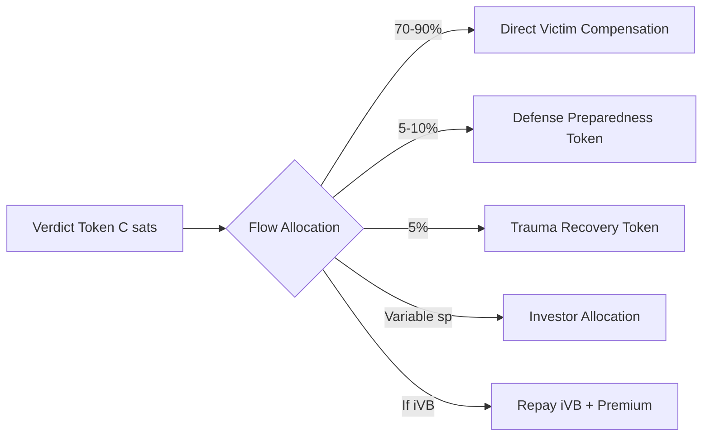

<!--
Source: https://phalynx.network/docs/economics — the route /docs/bonds renders this same page
Extracted: 2026-11-24 (America/New_York) from the public PhalynX Network site.
The site JS bundle was last-modified 2026-08-30 (HTTP Last-Modified on https://phalynx.network/assets/index-DQnlPCMO.js).
This file is a faithful Markdown conversion of the published page. Mermaid diagrams
were restored from the site source bundle. No protocol content was invented.
-->

# Economics

Bond mechanics, reputation scaling formulas, and settlement payout ordering for the PhalynX Network protocol.

> **Governance Integration**
>
> Bond calculations integrate with the [Governance](governance.md) layer's multi-tiered compensation system: Localized Compensation Tables (LCT), Personal Compensation Standards (PCS), and Institutional Compensation Standards (ICS). See the governance documentation for details on how individual autonomy merges with community baselines.

## Bond Formulas

### Victim Bond (VB)

The Victim Bond is scaled inversely by Reputation Index (RI), making it more expensive for low-reputation claimants to file cases:

```typescript
// VB = clamp(VbMin, VbMax, α × ClaimValue × f(RI))
// where f(RI) = RI_high / max(RI, RI_floor)

interface BondParams {
  alpha: number;      // Scaling factor (default: 0.1)
  vbMin: number;      // Minimum VB (default: $50)
  vbMax: number;      // Maximum VB (default: $5,000)
  riHigh: number;     // High RI baseline (default: 1.0)
  riFloor: number;    // RI floor to prevent division by zero (default: 0.1)
}

function calculateVictimBond(
  claimValue: number,
  ri: number,
  params: BondParams
): number {
  // Reputation scaling function
  // f(RI) = RI_high / max(RI, RI_floor)
  const f_ri = params.riHigh / Math.max(ri, params.riFloor);

  // Base bond calculation
  const baseBond = params.alpha * claimValue * f_ri;

  // Clamp to min/max bounds
  return Math.max(
    params.vbMin,
    Math.min(params.vbMax, baseBond)
  );
}

// Example calculations:
// RI = 1.0 (high rep), Claim = $10,000 → VB = $1,000
// RI = 0.5 (medium rep), Claim = $10,000 → VB = $2,000
// RI = 0.1 (low rep), Claim = $10,000 → VB = $5,000 (capped)
```

### Defendant Bond (DB)

The Defendant Bond is proportional to the claim value to ensure adequate coverage:

```typescript
function calculateDefendantBond(
  claimValue: number,
  params: { dbMultiplier: number }
): number {
  // DB = ClaimValue × multiplier
  // Default multiplier: 1.2 (120% of claim)
  return claimValue * params.dbMultiplier;
}

// Example:
// Claim = $10,000 → DB = $12,000
```

## Parameter Defaults

| Parameter | Symbol | Default Value | Governance Phase |
| --- | --- | --- | --- |
| VB Scaling Factor | α | 0.1 | Phase 1+ |
| Minimum VB | VB\_min | $50 | Phase 1+ |
| Maximum VB | VB\_max | $5,000 | Phase 1+ |
| RI High Baseline | RI\_high | 1.0 | Phase 0 |
| RI Floor | RI\_floor | 0.1 | Phase 0 |
| DB Multiplier | μ\_DB | 1.2 | Phase 1+ |
| RI Damping Factor | β | 0.8 | Phase 1+ |
| Jury Panel Size | N\_jury | 7 | Phase 1+ |
| Quorum Threshold | Q | 0.5 (simple majority) | Phase 0 |

## Payout Ordering

### Guilty Verdict

When the jury finds the defendant guilty, payouts follow this order:

1. **Victim Compensation:** Up to Claim Value from DB
2. **Juror Rewards:** Proportional to stake, from remaining DB
3. **Victim Bond Return:** Full VB returned to victim
4. **Token Burn:** Any remaining DB is burned

```typescript
interface GuiltyPayout {
  victimCompensation: number;
  jurorRewards: number[];
  victimBondReturn: number;
  burnAmount: number;
}

function calculateGuiltyPayout(
  claimValue: number,
  db: number,
  vb: number,
  jurorStakes: number[]
): GuiltyPayout {
  let remaining = db;

  // 1. Victim compensation (up to claim value)
  const victimCompensation = Math.min(claimValue, remaining);
  remaining -= victimCompensation;

  // 2. Juror rewards (proportional split of 10% of remaining)
  const jurorPool = remaining * 0.1;
  remaining -= jurorPool;

  const totalStake = jurorStakes.reduce((a, b) => a + b, 0);
  const jurorRewards = jurorStakes.map(
    stake => (stake / totalStake) * jurorPool
  );

  // 3. Victim gets VB back
  const victimBondReturn = vb;

  // 4. Remaining DB is burned
  const burnAmount = remaining;

  return {
    victimCompensation,
    jurorRewards,
    victimBondReturn,
    burnAmount
  };
}
```

### Not Guilty Verdict

When the jury finds the defendant not guilty:

1. **Defendant Bond Return:** Full DB returned to defendant
2. **Juror Rewards:** Funded from victim's VB
3. **Knowledge Management:** Protocol analysis and case data processing funded from VB
4. **Threat Management:** Security and infrastructure costs funded from VB

```typescript
interface NotGuiltyPayout {
  defendantBondReturn: number;
  jurorRewards: number[];
  knowledgeManagement: number;
  threatManagement: number;
}

function calculateNotGuiltyPayout(
  vb: number,
  db: number,
  jurorStakes: number[]
): NotGuiltyPayout {
  let remaining = vb;

  // 1. Defendant gets DB back
  const defendantBondReturn = db;

  // 2. Juror rewards (60% of VB)
  const jurorPool = vb * 0.6;
  remaining -= jurorPool;

  const totalStake = jurorStakes.reduce((a, b) => a + b, 0);
  const jurorRewards = jurorStakes.map(
    stake => (stake / totalStake) * jurorPool
  );

  // 3. Knowledge management (20% of VB)
  const knowledgeManagement = vb * 0.2;
  remaining -= knowledgeManagement;

  // 4. Threat management (20% of VB)
  const threatManagement = remaining;

  return {
    defendantBondReturn,
    jurorRewards,
    knowledgeManagement,
    threatManagement
  };
}
```

## Reputation Updates

Reputation Index (RI) is updated after each case based on the verdict:

```typescript
// RI update formula with damping
// RI_new = β × RI_old + (1 − β) × OutcomeScore
// where β = 0.8 (damping factor) and OutcomeScore ∈ [0, 1]

function updateReputation(
  currentRI: number,
  verdict: "GUILTY" | "NOT_GUILTY"
): { victimRI: number; defendantRI: number } {
  const beta = 0.8;

  if (verdict === "GUILTY") {
    // Victim wins: OutcomeScore = 1
    const victimRI = beta * currentRI + (1 - beta) * 1.0;
    // Defendant loses: OutcomeScore = 0
    const defendantRI = beta * currentRI + (1 - beta) * 0.0;

    return { victimRI, defendantRI };
  } else {
    // Victim loses: OutcomeScore = 0
    const victimRI = beta * currentRI + (1 - beta) * 0.0;
    // Defendant wins: OutcomeScore = 1
    const defendantRI = beta * currentRI + (1 - beta) * 1.0;

    return { victimRI, defendantRI };
  }
}

// Example:
// Current RI = 0.7
// β = 0.8
//
// Guilty verdict:
//   Victim RI: 0.8 × 0.7 + 0.2 × 1.0 = 0.56 + 0.20 = 0.76
//   Defendant RI: 0.8 × 0.7 + 0.2 × 0.0 = 0.56
```

> **Damping Rationale**
>
> The damping factor (β = 0.8) prevents extreme reputation swings from single cases while allowing gradual improvement or decline over time. See the [Reputation](reputation.md) page for complete details on RI calculation and event-based updates.

## Settlement Execution

All settlements are denominated in BTC and executed via buy-and-burn mechanics:

1. Verdict tokens are minted representing the settlement amount
2. Protocol buys BTC equivalent using the token (oracle price feed)
3. BTC is distributed to payees according to payout ordering
4. Verdict tokens are burned after settlement completes

> **Oracle Dependency**
>
> BTC price feeds use multiple oracles (Chainlink, Band, custom) with median aggregation to prevent manipulation.

## Victim Resilience Compensation

Traditional systems view restitution as merely **financial recovery**. PhalynX expands that to include **preventive empowerment** and **psychological repair** — ensuring that the same victim is statistically less likely to be victimized again.

### A) Restitution Token (RT)

The base layer token tied to the verdict (e.g., `RT-CaseID-UUID`). Represents the monetary component — loss, damages, and direct costs.

* **Face value:** `C` (jury-assessed claim)
* **Backing:** Bitcoin-sats escrowed / redeemed via verdict burns
* **Flows:** Divided between Victim, Investors, and optional iVB repayment as per bond formulas

### B) Defense Preparedness Token (DPT)

Issued as a **non-transferable voucher** to cover *physical resilience and defense training*. Redeemable only by certified trainers, shooting ranges, martial arts academies, or approved personal-defense services.

| Parameter | Example Value |
| --- | --- |
| Face Value | $1,000–$3,000 (varies by case severity) |
| Accepted by | Certified defense trainers within PhalynX registry |
| Expiration | 12 months (non-transferable, tied to victim ID) |
| Funded from | 5–10% of verdict token face value, automatically allocated |

### C) Trauma Recovery Token (TRT)

Issued to address *psychological and social recovery* — therapy, counseling, relocation, or digital privacy services.

| Parameter | Example Value |
| --- | --- |
| Face Value | $2,000–$5,000 typical |
| Accepted by | Licensed therapists, trauma counselors, relocation/legal aid partners |
| Expiration | 18 months |
| Funded from | Fixed portion (e.g., 5%) of verdict token allocation |

### D) Funding and Flow Integration



* Allocations are governed by smart-contract policy; total 100%.
* Victims can *claim* DPT/TRT through their authenticated PhalynX wallet (case-linked identity).
* Trainers and therapists redeem via verified provider nodes, receiving BTC equivalent.

### E) Why This Matters

1. **Breaks the cycle of victimhood** – The system doesn't just punish; it *fortifies*.
2. **Creates measurable social ROI** – Fewer repeat incidents reduce total network cost.
3. **Builds a verified service ecosystem** – Trainers, therapists, and aid providers earn via verifiable, reputation-based contracts.
4. **Encourages reintegration** – Victims engaging with DPT/TRT networks improve their *Victim Reputation Index (RIᵥ)*, lowering future bond costs.
5. **Reinforces data-driven governance** – Allocations for DPT/TRT can be dynamically adjusted through DAO voting based on observed success metrics.

### F) Example Allocation Table

| Category | Allocation % of C | Avg USD (for $100k Verdict) | Purpose |
| --- | --- | --- | --- |
| Victim Direct Compensation | 80% | $80,000 | Replace losses, damages |
| Defense Preparedness Token (DPT) | 10% | $10,000 | Defense training, protective gear |
| Trauma Recovery Token (TRT) | 5% | $5,000 | Therapy, counseling, relocation |
| Investor / Protocol / Float | 5% | $5,000 | Return & operational float |
| **Total** | **100%** | **$100,000** | — |

### G) Governance Notes

* **Dynamic weights:** DAO can adjust DPT/TRT share based on data (e.g., lower repeat victimization rates).
* **Honor Reputation:** Victims who *burn* unused DPT/TRT tokens receive **Honor RI** points → lowers future VB requirements.
* **Certified Providers:** Trainers and therapists gain **Provider RIₚ**, affecting instant payment percentages.
* **Auditable yet private:** Every redemption is hashed and timestamped on-chain, but victim identity remains encrypted.

> **PhalynX doesn't stop at restitution.**
>
> It creates a *self-reinforcing loop of safety* — compensating victims not just for what was lost, but equipping them to ensure it never happens again.
