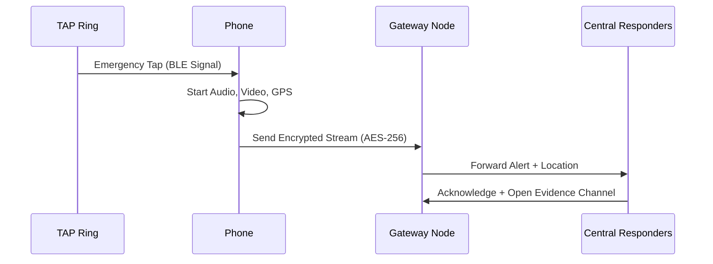
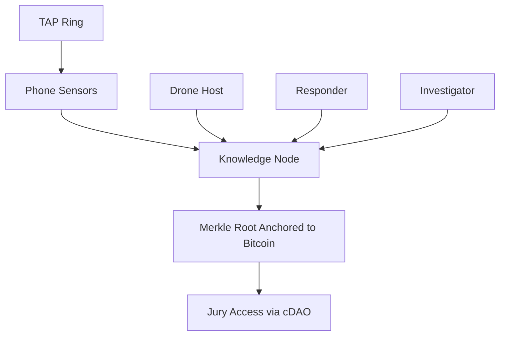
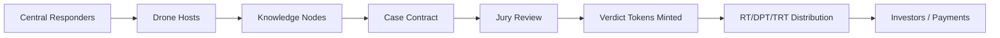

<!--
Source: https://phalynx.network/docs/evidence-pipeline
Extracted: 2026-11-24 (America/New_York) from the public PhalynX Network site.
The site JS bundle was last-modified 2026-08-30 (HTTP Last-Modified on https://phalynx.network/assets/index-DQnlPCMO.js).
This file is a faithful Markdown conversion of the published page. Mermaid diagrams
were restored from the site source bundle. No protocol content was invented.
-->

# Evidence Pipeline Protocol

How TAP devices, mobile sensors, responders, drones, and investigators capture, verify, and anchor truth into the PhalynX network.

> **The Nervous System of PhalynX**
>
> The Evidence Pipeline connects real-world incidents — recorded by smart rings, phones, drones, and responders — to the immutable digital ledger that jurors and Knowledge Nodes later use for verdicts.

Every element of the pipeline is designed for three goals:

1. **Integrity** — evidence can never be altered
2. **Neutrality** — no single actor controls what is seen or stored
3. **Automation** — capture begins instantly, even before human decisions

## Event Initiation (TAP Ring Activation)

### Trigger Conditions

The **TAP Ring** is the primary panic interface. When the user performs the configured gesture (e.g., two-second press or coded tap sequence), it immediately instructs the paired phone to:

1. **Begin recording audio** from all microphones
2. **Activate the front and rear cameras**
3. **Broadcast GPS coordinates** and motion telemetry
4. **Transmit signed alert packets** to the nearest Gateway Node

All actions are cryptographically signed by the ring's hardware ID and timestamped locally before transmission.



```typescript
// TAP Ring activation protocol
interface TAPActivation {
  ringId: string;           // Hardware ID
  timestamp: number;        // Local device time
  gesture: TapGesture;      // Pattern that triggered
  location: GPSCoordinates;
  signature: string;        // Signed by ring's private key
}

interface TapGesture {
  pattern: 'two-second-hold' | 'coded-sequence' | 'triple-tap';
  pressure: number;
  duration: number;
}

// Phone response upon receiving TAP signal
async function handleTAPActivation(signal: TAPActivation): Promise<void> {
  // Verify ring signature
  if (!await verifyRingSignature(signal)) {
    throw new Error('Invalid TAP ring signature');
  }

  // Immediate evidence capture
  await Promise.all([
    startAudioRecording('all-microphones'),
    activateCameras(['front', 'rear']),
    beginGPSTracking(),
    collectMotionTelemetry()
  ]);

  // Encrypt and transmit to Gateway Node
  const alertPacket = await encryptAlertPacket({
    ringId: signal.ringId,
    timestamp: signal.timestamp,
    location: signal.location,
    evidenceStreams: ['audio', 'video', 'gps', 'motion']
  });

  await transmitToGatewayNode(alertPacket);
}
```

> See the [Architecture](architecture.md) page for details on Gateway Nodes and the physical-to-digital bridge.

## Real-Time Threat Evaluation

The **Central Emergency Responders (CERs)** act as the network's triage system. They monitor live audio/video streams (with victim consent flag already implicit in the TAP activation) and perform:

* **Threat scoring** using AI-assisted models (speech stress, weapon detection, movement)
* **Classification:** Immediate danger / Ongoing altercation / Post-incident evidence only
* **Drone Dispatch Decision:** If live threat verified and drone hosts are available within radius, CERs can deploy them

Deployment signals are broadcast to registered drone hosts who have opted into the network's **Drone-for-Evidence (DfE)** program.

## Drone-for-Evidence (DfE) Sub-Protocol

### Drone Host Network

* Private individuals or companies register their drones with a **Drone Identity Token (DIT)**
* Drones maintain idle "ready" status within local mesh networks

### Dispatch & Recording

When dispatched:

1. Drone receives signed mission packet from CER containing GPS target, altitude limits, and expiry time
2. Drone activates camera feed and telemetry, encrypts with its DIT key, and streams directly to a Knowledge Node cluster
3. Drone operators receive compensation only if:
   * Flight logs match the mission packet, and
   * The footage passes integrity attestation

### Privacy Guardrails

* Drones record only within mission geofence and time window
* All non-relevant footage is automatically truncated by Knowledge Nodes using object-detection redaction models

## Knowledge Nodes (K-Nodes)

Knowledge Nodes are the network's impartial archivists.

| Function | Description |
| --- | --- |
| Validation | Verify signatures from Ring, Phone, Drone, or Responder |
| Hashing | Create Merkle root of every file block (audio, video, logs) |
| Anchoring | Commit Merkle roots to Bitcoin (RGB/OP\_RETURN) |
| Attestation | Sign integrity proofs shared with jury later |

Every piece of evidence is stored encrypted in IPFS and referenced by its content hash. K-Nodes never view raw data unless authorized by the adjudication quorum.

> See the [Security](security.md) page for details on AES-256 encryption, SHA-256 hashing, and Bitcoin anchoring.

## On-Scene Responders & Testimony

Local **Threat Management Teams (TMTs)** or private responders who arrive at the scene become part of the evidentiary chain.

* Their body-cam feeds are captured and hashed the same way as drone and phone data
* After the event, TMT officers may submit a **Testimonial Packet** (voice, text, or signed report) through a Knowledge Node
* TMT testimony earns a micro-reward but does not control the investigation

All TMT evidence is labeled as "Responder Attestation" to differentiate from victim or drone feeds.

## Post-Incident Investigation

Sometimes evidence alone is insufficient. A **Neutral Investigator** may be appointed by the cDAO (case contract) using the following rules:

1. Investigator pool consists of bonded professionals with ≥0.7 RI and no prior relationship to victim or accused
2. Selection is random but weighted by geography and expertise
3. Investigator receives encrypted evidence subset + field access rights
4. Findings are summarized into a **Case Addendum Packet (CAP)** signed and uploaded through a Knowledge Node

The investigator's costs are paid from the case's operational budget (O = J + K + T).

> See the [Economics](economics.md) page for the operational cost formula and budget allocation.

## Chain of Custody

All devices and actors produce signed, time-sequenced attestations. Knowledge Nodes merge them into a **Chain-of-Custody (CoC)** ledger.



Each entry includes:

* device ID and public key
* timestamp
* location (optional)
* SHA-256 block hash
* parent-block reference (forming Merkle chain)

```typescript
// Chain of Custody entry
interface CoCEntry {
  deviceId: string;
  publicKey: string;
  timestamp: number;
  location?: GPSCoordinates;
  blockHash: string;        // SHA-256 of this entry
  parentHash: string;       // Reference to previous entry
  evidenceType: 'audio' | 'video' | 'gps' | 'telemetry' | 'testimony';
  signature: string;        // Signed by device private key
}

// Build Merkle chain of custody
async function buildChainOfCustody(entries: CoCEntry[]): Promise<string> {
  // Sort by timestamp
  const sortedEntries = entries.sort((a, b) => a.timestamp - b.timestamp);

  // Verify each entry links to previous
  for (let i = 1; i < sortedEntries.length; i++) {
    if (sortedEntries[i].parentHash !== sortedEntries[i - 1].blockHash) {
      throw new Error(`Chain of custody broken at entry ${i}`);
    }

    // Verify signature
    if (!await verifySignature(sortedEntries[i])) {
      throw new Error(`Invalid signature at entry ${i}`);
    }
  }

  // Calculate Merkle root
  const merkleRoot = await calculateMerkleRoot(sortedEntries.map(e => e.blockHash));

  // Anchor to Bitcoin
  await anchorToBitcoin(merkleRoot);

  return merkleRoot;
}
```

## Evidence Review by Jury

During adjudication:

1. Jurors access only hashed previews and metadata summaries until commit phase begins
2. Decryption keys are shared via threshold signature scheme (e.g., 4-of-7 jurors)
3. Once verdict is rendered, keys are destroyed, leaving only hash proofs and playback certificates

> See the [Jury Protocol](jury-protocol.md) page for details on how jurors access and review evidence during the commit-reveal voting process.

## Neutrality Protocol

| Decision Type | Who Decides | Safeguards |
| --- | --- | --- |
| Immediate Threat Response | Central Responders (CER) | Logged & auditable; no verdict authority |
| Drone Deployment | CER quorum + signed command | Time-bounded geofence |
| Investigation Scope | Case Micro-DAO | Randomized neutral investigator selection |
| Evidence Access | Jury quorum | Threshold decryption only |

This separation ensures no single party — not even responders or CER — can unilaterally determine the narrative or suppress data.

## Payment & Incentive Flow



* Drone Hosts and Responders are compensated from the same case operational budget O
* Investigators are funded when appointed
* All payouts are in BTC (Lightning) after the cDAO confirms data attestation integrity

> See the [Tokens](tokens.md) page for information on Lightning settlement and RGB token mechanics.

## Privacy & Victim Control

Victims retain ultimate control:

* They can revoke consent for post-incident public display of evidence once verdict finalized
* Redacted summaries remain for audit, preserving transparency without exposure
* In multi-victim cases, individual consent flags must be unanimous for publication

## Summary

| Stage | Responsible Actors | Output |
| --- | --- | --- |
| Capture | Ring, Phone, Drone, Responders | Encrypted media streams |
| Validation | Knowledge Nodes | Hash + Attestation |
| Anchoring | Bitcoin RGB | Immutable proof of existence |
| Investigation | Neutral Investigator | Case Addendum Packet |
| Review | Jury | Verdict + Compensation Split |
| Settlement | Protocol | Token mint & restitution |

> **Cryptographic Truth**
>
> In PhalynX, evidence is not testimony — it is cryptographic truth. From the TAP Ring to Bitcoin anchoring, every step is designed to ensure that no one can erase reality once it has been seen.
