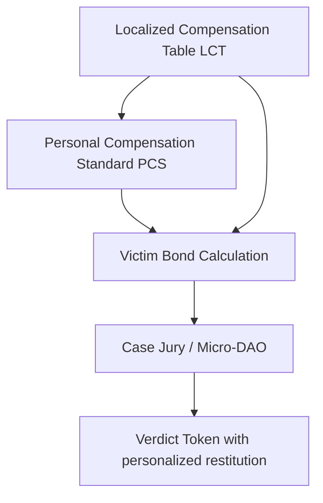

<!--
Source: https://phalynx.network/docs/governance
Extracted: 2026-11-24 (America/New_York) from the public PhalynX Network site.
The site JS bundle was last-modified 2026-08-30 (HTTP Last-Modified on https://phalynx.network/assets/index-DQnlPCMO.js).
This file is a faithful Markdown conversion of the published page. Mermaid diagrams
were restored from the site source bundle. No protocol content was invented.
-->

# Governance

Multi-phase governance evolution and the Personal Compensation Standards system that merges individual autonomy with community baselines.

## Governance Phases

The PhalynX protocol evolves through three distinct governance phases, progressively decentralizing control:

| Phase | Control | Description |
| --- | --- | --- |
| **0: Founding** | Admin multisig | Development, early pilots, initial parameter setting. |
| **1: Parameterized** | Stakeholders | Bonds, RI decay, quorum, and LCT baselines adjustable by vote. |
| **2: Decentralized** | On-chain governance | Parameter & upgrade proposals via VToken holders. Full DAO control. |

> **Proof-of-Victim**
>
> All governance actions are subject to **Proof-of-Victim**: only those with validated participation history can propose parameter changes. This ensures governance decisions are made by those with skin in the game.

## Personal Compensation Standards (PCS)

Beyond community-level norms, PhalynX allows each individual to define their own **Personal Compensation Standard (PCS)** — the value they assign to being harmed, wronged, or endangered.

This adds a market-based personalization layer to justice:*a person's value of harm is self-declared, auditable, and economically anchored.*

### Base Personal Restitution Value (PRV)

Each registered participant can set a **Base Personal Restitution Value (PRV)** — the amount they consider fair compensation for one unit of harm (e.g., "one day of lost work," "minor assault").

This value directly affects:

* The **potential restitution size** in a case
* The **required Victim Bond (VB)** to initiate a claim

### Formula Extension

The Victim Bond calculation incorporates the Personal Restitution Value:

```typescript
// VB with PCS integration
// VB = max(VB_min, min(VB_max, γ × O × g(RI) × h(PRV)))

interface PCSParams {
  gamma: number;           // Scaling factor (default: 0.1)
  vbMin: number;          // Minimum VB
  vbMax: number;          // Maximum VB
  riHigh: number;         // High RI baseline (default: 1.0)
  riFloor: number;        // RI floor to prevent division by zero (default: 0.1)
}

function g_RI(ri: number, riHigh: number, riFloor: number): number {
  // Reputation scaling function (inverse relationship)
  return riHigh / Math.max(ri, riFloor);
}

function h_PRV(prv: number, lctBaseline: number): number {
  // Personal compensation scaling tied to local baseline
  return prv / lctBaseline;
}

function calculateVBWithPCS(
  claimValue: number,     // O: offense/claim value
  ri: number,
  prv: number,
  lctBaseline: number,
  params: PCSParams
): number {
  // Reputation scaling
  const g_ri = g_RI(ri, params.riHigh, params.riFloor);

  // Personal compensation scaling
  const h_prv = h_PRV(prv, lctBaseline);

  // Complete VB calculation with all factors
  const baseVB = params.gamma * claimValue * g_ri * h_prv;

  // Clamp to min/max bounds
  return Math.max(
    params.vbMin,
    Math.min(params.vbMax, baseVB)
  );
}

// Example:
// Claim Value = $10,000
// RI = 0.5 (medium reputation)
// PRV = $10,000 (personal assault standard)
// LCT baseline = $2,000 (community assault standard)
//
// Calculations:
// g(RI) = 1.0 / max(0.5, 0.1) = 2.0
// h(PRV) = 10,000 / 2,000 = 5.0
// VB = 0.1 × 10,000 × 2.0 × 5.0 = $10,000
//
// Higher VB required due to:
// - Medium RI (2x multiplier)
// - Above-baseline PRV (5x multiplier)
```

> The higher the PRV relative to the community baseline, the higher the VB required. This prevents frivolous high-value claims while preserving individual autonomy.

## Transparency and Social Dynamics

Every individual's PRV setting is **publicly viewable** via a registry interface, creating transparent expectations:

| Identity | Category | PRV (USD) | Multiplier vs. Baseline | VB Impact |
| --- | --- | --- | --- | --- |
| `high.value.exec` | Assault | $1,000,000 | ×500 | Very High |
| `community.member` | Assault | $2,000 | ×1 | Normal |
| `budget.conscious` | Assault | $500 | ×0.25 | Low |

Jurors and investors can view these tables when evaluating case seriousness and risk. This transparency creates **accountability** — if someone values their time or safety higher, they accept the financial responsibility of bringing claims at that scale.

## Incentive Alignment

| Scenario | Victim Action | Network Response |
| --- | --- | --- |
| Victim sets very high PRV | Higher VB required; investors expect high-quality evidence; defendant's reputation loss larger if guilty. | Prevents frivolous high-value claims. |
| Victim sets low PRV | Lower VB; smaller payouts; faster resolutions. | Keeps casual disputes economical. |
| Victim repeatedly raises PRV but loses cases | VB multiplier automatically increases via Reputation dampening. | Discourages inflationary self-valuation. |

This keeps the system fair while enabling autonomy.

## Institutional Compensation Standards (ICS)

Public spaces, companies, or private venues can register**Institutional Compensation Standards (ICS)** to define baseline restitution expectations on their premises.

### Example ICS Registry

| Venue | Category | Restitution Baseline | Public Notice |
| --- | --- | --- | --- |
| `marsport.concerthall` | Battery | $25,000 | Displayed via QR at entrance |
| `liberty.bar` | Theft | $3,000 | Linked to venue policy contract |
| `tech.conference` | Harassment | $10,000 | Published in event TOS |

Visitors implicitly **opt-in** by entering or digitally signing venue TOS (using their PhalynX wallet). If an incident occurs, the case automatically references that venue's ICS as the default baseline unless overridden by the victim's PRV (whichever is higher).

## Localized Compensation Tables (LCT)

Each jurisdiction or community maintains a **Localized Compensation Table**that sets baseline compensation values for different crime categories. These serve as the reference point for PCS calculations.

```typescript
interface LCTEntry {
  jurisdiction: string;
  category: string;
  baselineUSD: number;
  lastUpdated: string;
  governancePhase: number;
}

// Example LCT for Próspera, Honduras
const prosperaLCT: LCTEntry[] = [
  {
    jurisdiction: "prospera",
    category: "PROPERTY_DAMAGE_MINOR",
    baselineUSD: 500,
    lastUpdated: "2025-10-01",
    governancePhase: 1
  },
  {
    jurisdiction: "prospera",
    category: "ASSAULT_MINOR",
    baselineUSD: 2000,
    lastUpdated: "2025-10-01",
    governancePhase: 1
  },
  {
    jurisdiction: "prospera",
    category: "THEFT",
    baselineUSD: 1000,
    lastUpdated: "2025-10-01",
    governancePhase: 1
  },
  {
    jurisdiction: "prospera",
    category: "PRIVACY_VIOLATION",
    baselineUSD: 3000,
    lastUpdated: "2025-10-01",
    governancePhase: 1
  }
];
```

## Governance Integration

The multi-layered compensation system integrates seamlessly with the governance and settlement flows:



### Governance Node Auditing

Governance nodes audit PCS distributions periodically to detect outliers and exploitative behavior:

```typescript
interface PCSAuditReport {
  jurisdiction: string;
  category: string;
  statistics: {
    mean: number;
    median: number;
    standardDeviation: number;
    outlierCount: number;
  };
  flaggedAccounts: string[];
  timestamp: string;
}

function auditPCSDistribution(
  category: string,
  jurisdiction: string,
  allPRVs: number[]
): PCSAuditReport {
  const mean = allPRVs.reduce((a, b) => a + b) / allPRVs.length;
  const sorted = [...allPRVs].sort((a, b) => a - b);
  const median = sorted[Math.floor(sorted.length / 2)];

  const variance = allPRVs.reduce((sum, val) =>
    sum + Math.pow(val - mean, 2), 0) / allPRVs.length;
  const stdDev = Math.sqrt(variance);

  // Flag outliers (3+ standard deviations from mean)
  const outlierThreshold = mean + (3 * stdDev);
  const flagged = allPRVs
    .map((prv, idx) => ({ prv, idx }))
    .filter(({ prv }) => prv > outlierThreshold)
    .map(({ idx }) => `account_${idx}`);

  return {
    jurisdiction,
    category,
    statistics: {
      mean,
      median,
      standardDeviation: stdDev,
      outlierCount: flagged.length
    },
    flaggedAccounts: flagged,
    timestamp: new Date().toISOString()
  };
}
```

### Statistical Reporting

Statistical reporting (mean, median, deviation) of PCS values by category improves policy calibration. Governance stakeholders use these metrics to:

* Adjust LCT baselines to reflect community standards
* Identify categories with high variance requiring intervention
* Detect coordinated manipulation attempts
* Calibrate VB multipliers for fairness

## Advantages

1. **Sovereignty** — Every person declares their own worth; the network prices it in economically.
2. **Transparency** — Publicly visible standards deter opportunistic overvaluation.
3. **Autonomic justice** — No authority dictates a ceiling for personal dignity.
4. **Market equilibrium** — Investors gravitate toward reasonable PCS profiles, naturally stabilizing compensation norms.
5. **Cultural interoperability** — A community's LCT sets social context; PCS personalizes within that context.

> **In PhalynX, value is not dictated by a court — it is declared by the individual, validated by peers, and enforced by math.**
>
> In PhalynX, value is not dictated by a court — it is declared by the individual, validated by peers, and enforced by math.

## Governance Proposal Process

In Phase 1 and 2, stakeholders can propose changes to:

* LCT baseline values for specific categories
* Maximum PRV multipliers allowed
* VB scaling parameters (γ, min, max)
* Outlier detection thresholds
* New crime categories and their baselines

```typescript
interface GovernanceProposal {
  proposalId: string;
  proposer: string;
  proposalType: "LCT_UPDATE" | "PARAMETER_CHANGE" | "NEW_CATEGORY";
  targetJurisdiction: string;
  changes: {
    category?: string;
    newBaseline?: number;
    parameterName?: string;
    newValue?: number;
  };
  votingPeriodEnds: string;
  requiredQuorum: number;
  currentVotes: {
    for: number;
    against: number;
    abstain: number;
  };
  status: "ACTIVE" | "PASSED" | "REJECTED" | "EXECUTED";
}

// Example: Updating LCT baseline for assault in Próspera
const exampleProposal: GovernanceProposal = {
  proposalId: "prop-2025-001",
  proposer: "0xGovernanceNode7",
  proposalType: "LCT_UPDATE",
  targetJurisdiction: "prospera",
  changes: {
    category: "ASSAULT_MINOR",
    newBaseline: 2500  // Up from 2000
  },
  votingPeriodEnds: "2025-11-01T00:00:00Z",
  requiredQuorum: 0.33,
  currentVotes: {
    for: 127,
    against: 23,
    abstain: 8
  },
  status: "ACTIVE"
};
```

> **Voting Power**
>
> Voting power is weighted by:
>
> * Reputation Index (RI) — participants with proven case history
> * Stake amount — economic skin in the game
> * Time in network — longer participation = higher weight
