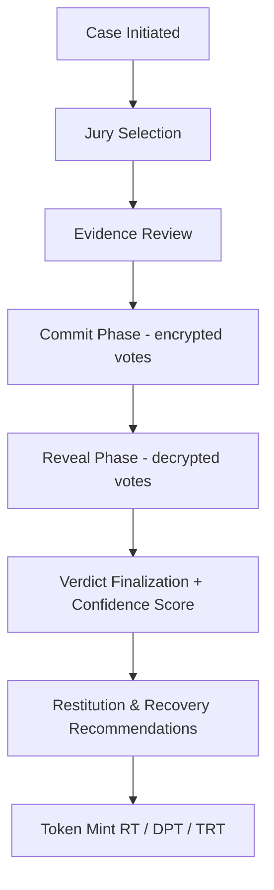
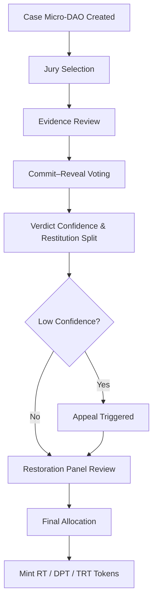

<!--
Source: https://phalynx.network/docs/jury-protocol
Extracted: 2026-11-24 (America/New_York) from the public PhalynX Network site.
The site JS bundle was last-modified 2026-08-30 (HTTP Last-Modified on https://phalynx.network/assets/index-DQnlPCMO.js).
This file is a faithful Markdown conversion of the published page. Mermaid diagrams
were restored from the site source bundle. No protocol content was invented.
-->

# Jury Protocol

How jurors are selected, vote, and participate in defining compensation and recovery within the PhalynX justice protocol.

> **Human Consensus Layer**
>
> The PhalynX Jury Protocol is the human consensus layer of decentralized justice. Jurors transform verified evidence into verifiable outcomes: guilt, restitution, and recovery recommendations.

## Overview

Each case is assigned a **Case Micro-DAO (cDAO)** that manages selection, voting, and payout logic. Jurors participate anonymously, bonded by stake, and reputation-weighted for influence.

A typical case involves:

* **7 Jurors** (odd number to prevent ties)
* **Commit–reveal voting** for verdict and compensation
* **Reputation-weighted averaging**
* Optional **Restoration Panel** for trauma and training allocation

## Jury Lifecycle



## Jury Selection

### Eligibility Criteria

| Parameter | Description |
| --- | --- |
| Reputation Index (RI) | ≥ 0.6 required; decays over inactivity |
| Stake Bond | Minimum 0.01 BTC-equivalent in collateral |
| Training | Jurors must pass an impartiality & privacy certification quiz |
| Rotation | Selected randomly via VRF seed derived from Bitcoin block hash |

### Selection Flow

1. Knowledge Nodes broadcast "Case Ready" signal
2. Eligible jurors register interest
3. VRF (Verifiable Random Function) chooses jurors pseudorandomly weighted by RI
4. Selected jurors are announced to the cDAO (pseudonymously)

## Commit–Reveal Voting

Jurors cast two classes of votes:

1. **Verdict Vote** → GUILTY or NOT GUILTY
2. **Restitution Recommendation Vote** → proportion of compensation to:
   * Direct Restitution (RT)
   * Defense/Training (DPT)
   * Trauma Recovery (TRT)

Each vote is encrypted and committed to the chain as a hash, then revealed after all commits are in.

```typescript
// Commit phase: hash vote with random nonce
interface VoteCommit {
  jurorId: string;
  voteHash: string;  // SHA256(vote + nonce)
  timestamp: number;
  caseId: string;
}

interface Vote {
  verdict: 'GUILTY' | 'NOT_GUILTY';
  restitution: {
    RT: number;   // percentage (0-100)
    DPT: number;  // percentage (0-100)
    TRT: number;  // percentage (0-100)
  };
  nonce: string;  // random bytes for privacy
}

// Commit vote hash to blockchain
async function commitVote(vote: Vote, jurorId: string): Promise<string> {
  const voteString = JSON.stringify(vote);
  const voteHash = await sha256(voteString + vote.nonce);

  await submitToChain({
    jurorId,
    voteHash,
    timestamp: Date.now()
  });

  return voteHash;
}

// Reveal phase: submit original vote + nonce
async function revealVote(vote: Vote, jurorId: string): Promise<void> {
  // Blockchain verifies hash matches commit
  await verifyAndReveal({
    jurorId,
    vote,
    nonce: vote.nonce
  });
}
```

## Verdict Confidence Weighting

Verdict confidence is calculated as a weighted consensus, not binary. Weights derive from juror reputation and historical accuracy.

| Outcome | Confidence Range | Action |
| --- | --- | --- |
| 100–90% | Tier 1 Verdict | Final; mint tokens immediately |
| 89–70% | Tier 2 Verdict | Auto-review by Restoration Panel |
| <70% | Low Confidence | Automatic Appeal triggered |

Mathematically:

Cverdict = (Σ (RIi × Vi)) / Σ RIi

Where Vi = 1 for guilty vote, 0 for not guilty

## Compensation Recommendation Logic

Jurors also vote on how restitution is divided. This ensures the people reviewing the harm — not an algorithm — decide how recovery funds are used.

Each juror submits three proportional votes that must sum to 100%:

| Component | Default | Description |
| --- | --- | --- |
| RT | 80% | Direct restitution (economic losses) |
| DPT | 10% | Defense preparedness (training/equipment) |
| TRT | 10% | Trauma recovery (therapy/wellness) |

After votes are revealed, PhalynX calculates the weighted mean:

RDPT = (Σ (RIi × DPTi)) / Σ RIi

RTRT = (Σ (RIi × TRTi)) / Σ RIi

The Restitution Token minting contract then encodes those proportions.

> See the [Tokens](tokens.md) page for detailed information on how RT, DPT, and TRT are minted and redeemed.

## Optional Restoration Panel

In some cases, a second group — the **Restoration Panel** — reviews only the trauma and defense allocations, leaving guilt verdicts to the original jury.

This group can include:

* Trauma specialists
* Personal safety professionals
* Certified victim advocates

### Purpose

* Advise or override juror recommendations when they deviate too far from local averages
* Ensure funds go to categories with the most real-world benefit
* Submit recommendations signed by a Panel Multisig; the cDAO merges them via on-chain proposal

### Trigger Conditions

| Condition | Threshold |
| --- | --- |
| Jury confidence | < 85% |
| Compensation deviation from local LCT norms | > 25% |
| Appeal initiated | By victim or accused |

## Juror Incentives & Reputation

| Action | Reward / Penalty | Effect on RI |
| --- | --- | --- |
| Majority alignment | +RI, partial BTC bonus | Builds trustworthiness |
| Outlier but justified (appeal upheld) | Neutral | Preserves independence |
| Dishonest / inactive | Slashed stake, -RI | Removes bad actors |
| Restoration participation | Bonus +RI | Encourages continued service |

Juror RI updates after every case, maintaining a distributed reputation ledger.

> See the [Governance](governance.md) page for more information on how Reputation Index (RI) is calculated and used throughout the protocol.

## Transparency & Privacy Balance

* Juror identities are hidden behind pseudonyms but vote hashes are public
* Reputation scores are viewable without linking to human identities
* All verdicts and vote breakdowns are visible via the PhalynX Explorer:
  * Verdict confidence
  * Average DPT/TRT allocation ratios
  * Appeals triggered

This allows the public to audit fairness trends without exposing individuals.

## Example Case

| Category | Value |
| --- | --- |
| Case Type | Assault |
| Claim Value (C) | $100,000 |
| Jury Votes | 6 Guilty / 1 Not Guilty |
| Verdict Confidence | 92% |
| Jury Avg Split | RT 78%, DPT 12%, TRT 10% |

Restoration Panel reviews and confirms jury proportions.

**Minted tokens:**

* **RT:** $78,000 equivalent in BTC
* **DPT:** $12,000 equivalent
* **TRT:** $10,000 equivalent

**Total = 100%** of restitution token issuance.

## Jury + Restoration Flow



## Why Jury-Controlled Restitution Matters

1. **Contextual empathy:** Jurors who review evidence best understand impact.
2. **Decentralized governance:** Restitution flows are decided democratically, not algorithmically.
3. **Restorative focus:** Splitting into DPT and TRT ensures victims heal and strengthen.
4. **Expert override:** Restoration Panels balance emotion with expertise.
5. **Transparency:** Weighted averages published publicly for accountability.

> **Human Judgment Verified by Code**
>
> In PhalynX, juries do more than declare guilt. They shape justice — balancing restitution, prevention, and healing through human judgment verified by code.
