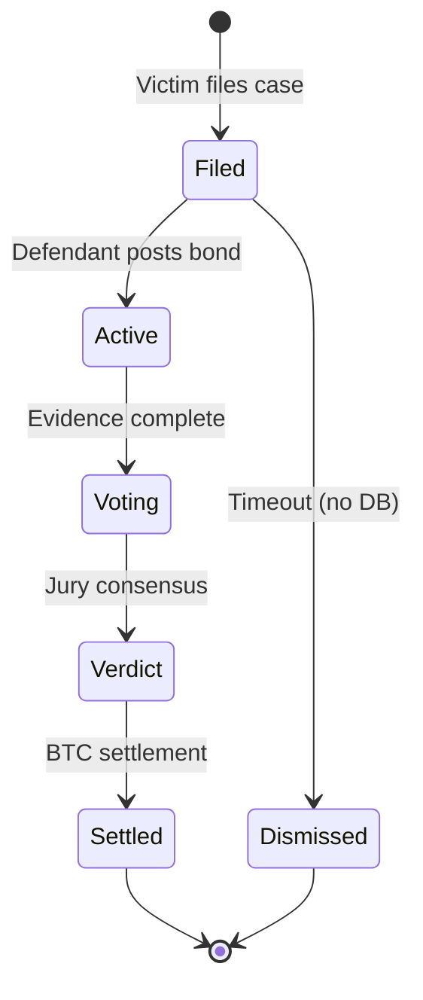

<!--
Source: https://phalynx.network/docs/protocol
Extracted: 2026-11-24 (America/New_York) from the public PhalynX Network site.
The site JS bundle was last-modified 2026-08-30 (HTTP Last-Modified on https://phalynx.network/assets/index-DQnlPCMO.js).
This file is a faithful Markdown conversion of the published page. Mermaid diagrams
were restored from the site source bundle. No protocol content was invented.
-->

# Protocol Specification

Formal specification of message types, event schemas, and state machines for the PhalynX Network protocol.

## Message Types

All protocol messages include standard fields for identity, integrity, and ordering:

```typescript
interface BaseMessage {
  id: string;              // UUID v4
  type: MessageType;       // Event discriminator
  timestamp: string;       // ISO 8601 UTC
  signature: string;       // Ed25519 signature
  nonce: number;           // Monotonic counter
}
```

## Event Schemas

### SOS Event

Initiates a new case with emergency context:

```json
{
  "id": "550e8400-e29b-41d4-a716-446655440000",
  "type": "SOS",
  "timestamp": "2025-10-22T14:30:00Z",
  "signature": "0x1a2b3c...",
  "nonce": 1,
  "payload": {
    "victimId": "0xVictimAddress",
    "claimValue": 5000,
    "category": "PROPERTY_DAMAGE",
    "location": {
      "lat": 15.9932,
      "lon": -61.9450
    },
    "deviceId": "ring_camera_001"
  }
}
```

### Evidence Chunk

Streamed evidence data with Merkle proof:

```json
{
  "id": "550e8400-e29b-41d4-a716-446655440001",
  "type": "EVIDENCE_CHUNK",
  "timestamp": "2025-10-22T14:30:15Z",
  "signature": "0x1a2b3c...",
  "nonce": 2,
  "payload": {
    "caseId": "550e8400-e29b-41d4-a716-446655440000",
    "chunkIndex": 0,
    "totalChunks": 10,
    "dataHash": "sha256:a3f5d8...",
    "encryptedBlob": "base64_encrypted_data",
    "merkleProof": ["hash1", "hash2", "hash3"]
  }
}
```

### Attestation

Knowledge Node attestation of evidence integrity:

```json
{
  "id": "550e8400-e29b-41d4-a716-446655440002",
  "type": "ATTESTATION",
  "timestamp": "2025-10-22T14:35:00Z",
  "signature": "0xKnowledgeNode...",
  "nonce": 1,
  "payload": {
    "caseId": "550e8400-e29b-41d4-a716-446655440000",
    "merkleRoot": "sha256:d9e1f2...",
    "evidenceCount": 10,
    "nodeId": "knowledge_node_alpha",
    "attestationType": "COMPLETE"
  }
}
```

### Verdict

Jury consensus verdict with vote breakdown:

```json
{
  "id": "550e8400-e29b-41d4-a716-446655440003",
  "type": "VERDICT",
  "timestamp": "2025-10-22T16:00:00Z",
  "signature": "0xJuryPanel...",
  "nonce": 1,
  "payload": {
    "caseId": "550e8400-e29b-41d4-a716-446655440000",
    "verdict": "GUILTY",
    "voteBreakdown": {
      "guilty": 5,
      "notGuilty": 2
    },
    "jurorIds": [
      "0xJuror1",
      "0xJuror2",
      "0xJuror3",
      "0xJuror4",
      "0xJuror5",
      "0xJuror6",
      "0xJuror7"
    ],
    "consensusTimestamp": "2025-10-22T15:55:00Z"
  }
}
```

## State Machine

Case lifecycle follows a deterministic state machine:



### State Transitions

> **Transition Rules**
>
> * **Filed → Active:** Requires defendant to post DB within 72 hours
> * **Filed → Dismissed:** Automatic if DB timeout expires
> * **Active → Voting:** Triggered when evidence window closes
> * **Voting → Verdict:** Requires jury quorum (simple majority)
> * **Verdict → Settled:** Automated BTC settlement execution

## Signature Scheme

All messages are signed using Ed25519:

```typescript
import { sign, verify } from '@noble/ed25519';

// Sign message
async function signMessage(
  message: BaseMessage,
  privateKey: Uint8Array
): Promise<string> {
  const payload = JSON.stringify(message);
  const signature = await sign(payload, privateKey);
  return Buffer.from(signature).toString('hex');
}

// Verify signature
async function verifyMessage(
  message: BaseMessage,
  publicKey: Uint8Array
): Promise<boolean> {
  const payload = JSON.stringify(message);
  const sig = Buffer.from(message.signature, 'hex');
  return await verify(sig, payload, publicKey);
}
```

## Timestamp Ordering

Messages must be ordered by timestamp and nonce to prevent replay attacks:

```typescript
interface MessageValidator {
  validateOrder(msg: BaseMessage, lastNonce: number): boolean;
}

class DefaultValidator implements MessageValidator {
  validateOrder(msg: BaseMessage, lastNonce: number): boolean {
    // Nonce must be monotonically increasing
    if (msg.nonce <= lastNonce) return false;

    // Timestamp must be recent (within 5 minutes)
    const now = Date.now();
    const msgTime = new Date(msg.timestamp).getTime();
    const diff = Math.abs(now - msgTime);

    return diff < 5 * 60 * 1000; // 5 minutes
  }
}
```

> **Clock Skew**
>
> Nodes must synchronize clocks using NTP to prevent timestamp disputes. Messages with timestamps beyond acceptable skew are rejected.

## Error Codes

Standard error codes for protocol violations:

```typescript
enum ProtocolError {
  INVALID_SIGNATURE = 1001,
  NONCE_MISMATCH = 1002,
  TIMESTAMP_SKEW = 1003,
  UNKNOWN_MESSAGE_TYPE = 1004,
  INVALID_STATE_TRANSITION = 1005,
  INSUFFICIENT_BOND = 1006,
  MERKLE_VERIFICATION_FAILED = 1007,
  JURY_QUORUM_NOT_MET = 1008,
}
```
