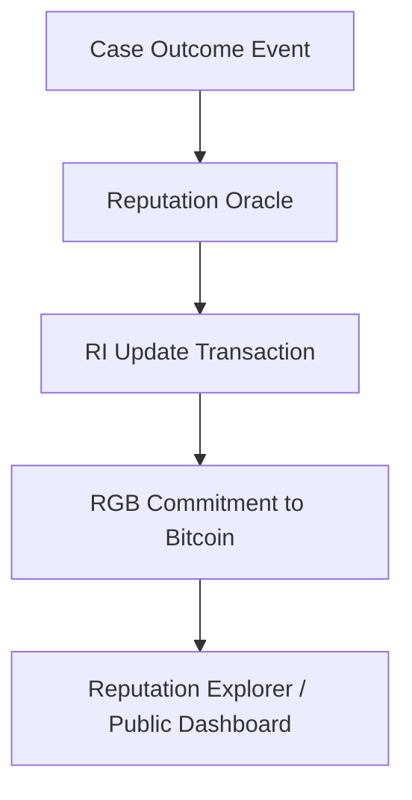
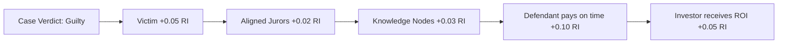

<!--
Source: https://phalynx.network/docs/reputation
Extracted: 2026-11-24 (America/New_York) from the public PhalynX Network site.
The site JS bundle was last-modified 2026-08-30 (HTTP Last-Modified on https://phalynx.network/assets/index-DQnlPCMO.js).
This file is a faithful Markdown conversion of the published page. Mermaid diagrams
were restored from the site source bundle. No protocol content was invented.
-->

# Reputation Protocol

How PhalynX quantifies trust, integrity, and reliability across victims, jurors, investigators, investors, and responders.

> **Reputation as Economic Gravity**
>
> PhalynX uses a Reputation Index (RI) to measure the trustworthiness and reliability of every network participant. Reputation influences bond sizes, voting power, jury selection, investor returns, and even evidence access.

Every action that strengthens truth or justice increases RI. Every dishonest, negligent, or exploitative act decreases it — immediately and visibly.

## Core Concept

| Property | Description |
| --- | --- |
| Metric | Scalar between 0 and 1.0 |
| Storage | Public, append-only Reputation Ledger (RGB sidechain) |
| Update Model | Event-driven, cryptographically signed |
| Decay Model | Exponential decay over time without participation |
| Visibility | Publicly queryable via wallet or block explorer |
| Privacy | No human identity stored — only pseudonymous keys |

Mathematically:

RInew = β × RIold + (1 − β) × OutcomeScore

Where:

* β = damping factor (default 0.8)
* OutcomeScore ∈ [0,1] derived from verified behavior in each event type

## Roles & Reputation Types

Different participants build reputation differently. Each role has its own **scoring events**, **weights**, and **penalties**.

| Role | Primary Actions | Reputation Sources |
| --- | --- | --- |
| Victims (V) | Filing claims, providing accurate data, cooperating with investigators | Case validity, evidence integrity, appeal outcomes |
| Defendants (A) | Timely payments, honest cooperation, lack of recidivism | Payment timeliness, zero fraudulent disputes |
| Jurors (J) | Voting accurately, meeting quorum deadlines | Consensus alignment, honesty proof |
| Knowledge Nodes (K) | Proper hashing, anchoring, uptime | Attestation accuracy, zero tampering |
| Investigators (I) | Neutral findings, completion speed | Peer reviews, absence of bias flags |
| Responders (TMT) | Reliability, response time, verified reports | Successful interventions, body-cam integrity |
| Investors (X) | Funding honest cases, high payout completion | ROI consistency, verified case success |

Each RI type is weighted by the **economic or ethical importance** of that actor's role.

## Reputation Update Events

| Event | Affected Role(s) | Delta RI |
| --- | --- | --- |
| Valid Case Filed (Guilty) | Victim | +0.05 |
| False or Dismissed Case | Victim | −0.10 |
| Case Paid Promptly (<30 days) | Defendant | +0.10 |
| Late Payment (>90 days) | Defendant | −0.05 (per period) |
| Jury Majority Alignment | Juror | +0.02 |
| Jury Minority but Correct on Appeal | Juror | +0.05 |
| Tampering / Vote Leak | Juror | −0.50 (plus slash) |
| Node Attestation Verified | Knowledge Node | +0.03 |
| Node Attestation Invalidated | Knowledge Node | −0.30 |
| Responder Integrity Verified | Responder | +0.05 |
| Investigator Bias Reported (confirmed) | Investigator | −0.25 |
| Investor Completes 95% Payback ROI | Investor | +0.05 |
| Investor Funds False Case | Investor | −0.10 |

All updates are executed by **Reputation Oracles** (stateless functions) and verified via the event's case hash.

## Reputation Weight in System Dynamics

### Victim Bonds

VB ∝ 1 / (RIv + ε)

Higher victim RI → lower required bond

> See the [Economics](economics.md) page for the complete victim bond formula and bond scaling mechanics.

### Jury Selection

Pselect = RIj / Σ RIpool

Higher RI increases chance of being selected

> See the [Jury Protocol](jury-protocol.md) page for details on jury selection and reputation-weighted voting.

### Juror Influence

VoteWeighti = RIi / Σ RIj

### Investor Allocation

Investors with high RI gain access to **higher-tier cases** (better ROI, lower fraud risk).

## Reputation Decay & Recovery

### Decay

Reputation slowly decreases over inactivity:

RIt = RI0 × e−λt

Default λ = 0.01 per month (≈10% loss per year of inactivity)

### Recovery

Participants can regain RI via:

* Verified service (jury duty, investigation, responder aid)
* Bonding honesty (staking RI on behavior)
* Completing mentorship or arbitration programs

## Hierarchical Reputation (RI Layers)

| Layer | Name | Aggregates |
| --- | --- | --- |
| RI₀ (Personal) | Base level | Actions of the individual |
| RI₁ (Role) | Per-role aggregation | Victim, Juror, etc. |
| RI₂ (Community) | Average of members in a locality or DAO | Used in governance weight |
| RI₃ (Network) | Global average, benchmark reference | Used for dynamic parameter scaling |

This multi-layer model prevents localized manipulation of reputation data — each community's scores roll up into the global anchor.

> See the [Governance](governance.md) page for how community and network-level RI influences governance decisions.

## Anti-Manipulation Controls

| Threat | Mitigation |
| --- | --- |
| Sybil attacks | Stake + Proof-of-Work ID + reputation throttling |
| Collusive juries | Random selection + stake slashing + correlation detection |
| Reputation farming | Nonlinear gain curve (diminishing returns >0.9 RI) |
| False flagging | Cross-role verification; flagged reports require 3 confirming nodes |
| RI inflation | Global normalization using z-score calibration |

## Reputation Ledger Architecture

Each RI update transaction includes:

* actor ID (pseudonymous pubkey)
* case hash
* role code
* delta value
* verifier signature
* timestamp

Anchored to Bitcoin for immutability, synced across all nodes.

## Transparency & Auditing

* Public Explorer lists average RI by role, region, and activity type
* Zero-knowledge proofs hide individual identities while verifying update legitimacy
* Governance audits can adjust formulas only via DAO proposals (anchored and logged)

**Example Explorer view:**

| Role | Global Mean RI | Active Members | Trend |
| --- | --- | --- | --- |
| Victims | 0.73 | 12,410 | ⬆️ |
| Jurors | 0.81 | 6,020 | ⬆️ |
| Responders | 0.65 | 1,200 | ➡️ |
| Knowledge Nodes | 0.92 | 210 | ⬆️ |
| Investors | 0.78 | 450 | ➡️ |

## Governance Interactions

* Minimum RI thresholds are defined in governance parameters
* DAO proposals to change weighting constants (β, λ, rewards) require ≥70% confidence and multi-role approval
* RI data informs policy auto-tuning — e.g., increase VB minimums in regions with low average RI

## Example Case Flow (Reputation Impact)

Each event signs its RI deltas and sends them to the Reputation Ledger for permanent record.

## Reputation as Economic Gravity

Reputation in PhalynX is not vanity — it's economic gravity.

| High RI (0.8–1.0) | Low RI (0.0–0.3) |
| --- | --- |
| Low VB cost | High VB cost |
| Jury priority selection | Jury exclusion |
| Low-interest iVB rates | High iVB premiums |
| Higher investor access | Limited access |
| Governance voting rights | No voting rights |
| Instant payouts | Delayed payouts |

Thus, every participant — human or node — is financially and socially motivated to stay honest, responsive, and consistent.

> **Reputation is Currency**
>
> In PhalynX, reputation is currency. It cannot be bought, only earned — and it is the foundation upon which decentralized justice stands.
