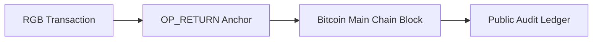
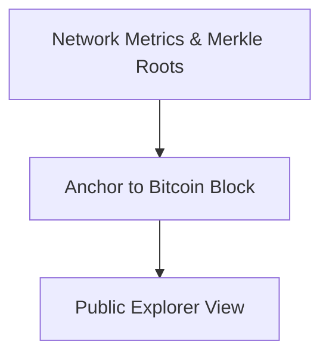

<!--
Source: https://phalynx.network/docs/security
Extracted: 2026-11-24 (America/New_York) from the public PhalynX Network site.
The site JS bundle was last-modified 2026-08-30 (HTTP Last-Modified on https://phalynx.network/assets/index-DQnlPCMO.js).
This file is a faithful Markdown conversion of the published page. Mermaid diagrams
were restored from the site source bundle. No protocol content was invented.
-->

# Security & Privacy Architecture

How PhalynX ensures cryptographic integrity, data privacy, and reputation-based trust across victims, jurors, and investors.

> **Security as Ethical Infrastructure**
>
> PhalynX treats security as both technical and ethical infrastructure. The protocol is designed so that *no single party* — not even a governance node — can alter evidence, change verdicts, or mint fraudulent compensation.

## Core Security Principles

| Principle | Description |
| --- | --- |
| End-to-End Encryption | All evidence and communication are encrypted client-side before network submission |
| Proof-of-Victim Requirement | No case exists without an identifiable, consenting victim — eliminating "victimless crimes" |
| Reputation over Authority | Trust is earned via consistent, verified behavior (RI), not centralized credentials |
| Transparency with Privacy | Case hashes and payment proofs are public; identities and raw data remain private |
| Immutable Anchoring | Every attestation and verdict is time-stamped and anchored to Bitcoin through RGB commitments |
| Zero-Trust Design | No participant, node, or admin can access unencrypted evidence without quorum keys |

## Evidence Handling

### Encryption & Hashing

* Victim or device encrypts each evidence object (AES-256) before upload
* SHA-256 hashes of evidence are stored off-chain; Merkle roots committed to Bitcoin every block (~10 min)
* Encryption keys are fragmented among jury members using **threshold cryptography (Shamir's Secret Sharing)**

```typescript
// Evidence encryption and hashing
interface EvidenceObject {
  id: string;
  encryptedData: Buffer;      // AES-256 encrypted
  hash: string;               // SHA-256 hash
  merkleProof: string[];      // Path to Merkle root
  keyShards: KeyShard[];      // Shamir secret shares
}

interface KeyShard {
  jurorId: string;
  threshold: number;          // Min shares needed (e.g., 2/3)
  shard: Buffer;              // Individual key fragment
}

async function encryptEvidence(
  rawData: Buffer,
  jurors: string[]
): Promise<EvidenceObject> {
  // Generate random AES-256 key
  const key = crypto.randomBytes(32);

  // Encrypt evidence
  const encrypted = await aes256Encrypt(rawData, key);

  // Generate SHA-256 hash
  const hash = sha256(rawData);

  // Split key using Shamir's Secret Sharing
  const keyShards = shamirSplit(key, jurors.length, Math.ceil(jurors.length * 2/3));

  return {
    id: generateId(),
    encryptedData: encrypted,
    hash,
    merkleProof: [],
    keyShards: keyShards.map((shard, i) => ({
      jurorId: jurors[i],
      threshold: Math.ceil(jurors.length * 2/3),
      shard
    }))
  };
}
```

### Tamper Detection

* Any alteration to evidence invalidates its hash tree
* Knowledge Nodes perform redundancy checks and publish signed "Integrity Attestations"
* Attestation failures automatically trigger network alerts and can pause verdict processing

### Juror Access Control

* Jurors only decrypt evidence after signing a commitment transaction to vote — preventing voyeurism or unauthorized access
* After verdict, keys are shredded and replaced by derived audit proofs

## Identity & Anonymity

### Victim Identity

* Victim real identity encrypted under jurisdictional key; pseudonymous case ID used everywhere else
* Optional "proxy victim identity" allows legal guardians or organizations to act on behalf of minors or incapacitated persons

### Juror Pseudonymity

* Jurors vote via **zero-knowledge commit-reveal proofs**; votes are auditable but unlinkable
* Juror metadata (uptime, RI, stake) is public, but human identity is not

### Reputation Index (RI)

* Each actor (Victim, Defendant, Juror, Provider, Investor) has an RI score between 0-1
* Updates only after cryptographically confirmed outcomes
* Stored on the **Reputation Ledger**, a lightweight RGB sidechain optimized for signed scalar updates

## Network Integrity

### Node Roles

| Node Type | Function | Security Model |
| --- | --- | --- |
| Knowledge Node (K) | Evidence validation, hash anchoring | Signed attestations, stake-backed |
| Protocol Node (P) | Smart contract execution, token mint/burn | Consensus quorum, slashing if dishonest |
| Governance Node (G) | Parameter proposals, LCT updates | Multisig + audit log |
| Gateway Node (GW) | Off-chain interface for apps and rings | Ephemeral tokens, no data retention |

All node communications use mutual TLS with session-specific keys rotated every 15 minutes.

### Consensus & Slashing

* Any node proven to submit invalid attestations or double-mint tokens is **slashed** (stake burned) and **reputation reset to 0**
* Detected collusion > 2% of total node set automatically triggers network-wide challenge protocol and re-election

### Redundancy

* Evidence and ledger data are redundantly stored across 5+ geographic zones via IPFS clusters
* No single region failure can halt verdict settlement

## Financial Security

### Token Minting Controls

* RT, DPT, TRT tokens can only be minted from a **signed verdict contract** referencing a valid case hash and jury quorum signature
* Mint transactions require ≥ 2/3 multi-sig of Knowledge + Protocol Nodes
* Any mismatch between case hash and mint metadata invalidates issuance

### Bitcoin Anchoring



Each token or verdict action includes:

* RGB contract ID
* Case Hash (SHA-256)
* Juror quorum signature aggregate

Anchored every ~10 minutes, ensuring external auditability from the Bitcoin network itself.

### Smart Escrow for Payments

* Defendant payments use multi-sig Lightning invoices: {Defendant, Victim, Protocol}
* Prevents false settlement proofs; all burns require dual confirmation
* Partial payments reduce outstanding token supply pro-rata

```typescript
// Multi-sig Lightning escrow
interface EscrowPayment {
  defendant: string;
  victim: string;
  protocol: string;
  amount: number;           // satoshis
  tokenId: string;          // RT being repaid
  signatures: {
    defendant: string;
    victim?: string;        // Optional early release
    protocol: string;
  };
}

async function settlePayment(payment: EscrowPayment): Promise<BurnEvent> {
  // Verify multi-sig: defendant + protocol required
  // Victim signature optional for early settlement
  const signaturesValid =
    verify(payment.defendant, payment.signatures.defendant) &&
    verify(payment.protocol, payment.signatures.protocol);

  if (!signaturesValid) {
    throw new Error('Invalid multi-sig for settlement');
  }

  // Burn corresponding RT tokens
  const burnAmount = payment.amount;
  await burnTokens(payment.tokenId, burnAmount);

  // Anchor burn event to Bitcoin
  return anchorBurnEvent(payment);
}
```

## Privacy & Data Lifecycle

| Stage | Mechanism | Retention |
| --- | --- | --- |
| Capture | Local client encryption (AES-256, ephemeral keys) | none unencrypted |
| Transit | TLS + Noise Protocol | transient only |
| Storage | IPFS w/ Merkle Pinning | until verdict + 1 yr retention |
| Deletion | Cryptographic shredding of keys | enforced by Knowledge Node quorum |
| Audit | Zero-knowledge proof of deletion (zk-DEL) | permanently recorded |

> Victims can request early data purge via "zero-knowledge erasure requests," preserving audit proof without exposing data.

## Threat Model Overview

| Threat | Mitigation |
| --- | --- |
| Node collusion | stake-weighted quorum signatures + random rotation |
| Evidence tampering | hash-tree commitments anchored to Bitcoin |
| Juror bribery | commit-reveal + random selection + slashing |
| DoS / spam filings | dynamic VB scaling and RI throttling |
| Identity deanonymization | zk-pseudonyms + jurisdictional key splitting |
| Financial fraud | Lightning escrow + on-chain burns |
| Smart-contract bugs | formal verification + upgrade voting quorum |

## Security Governance

* **Open Source Audits** – all cryptographic libraries are open and externally audited
* **Emergency Pauses** – any node quorum (> 2/3) may freeze minting upon exploit detection
* **Multi-Sig Recovery** – lost private keys can be reconstituted via 3-of-5 jurisdictional custodians
* **Insurance Layer (future)** – stake-pooled fund compensates for verified protocol-level losses

## Transparency Reports

Every epoch (~10 minutes):

* Published Merkle root of active cases, verdicts, and token balances
* Public metrics:
  * total cases resolved
  * average verdict confidence
  * total RT/DPT/TRT issued and burned
  * network uptime & slashing events



> **Cryptographically Protected Truth**
>
> PhalynX's security model fuses Bitcoin's immutability, threshold cryptography, and reputation-based trust into a single ecosystem where:
>
> * No central actor can alter justice
> * Every action is mathematically provable
> * Privacy coexists with transparency
>
> It is a justice network where truth is cryptographically protected and privacy is a human right embedded in the codebase.
