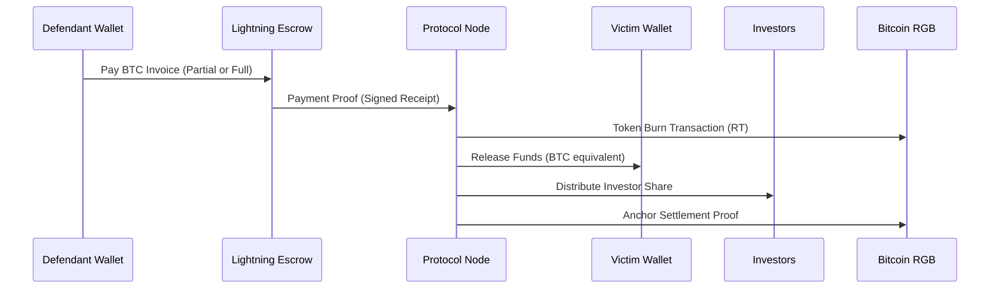
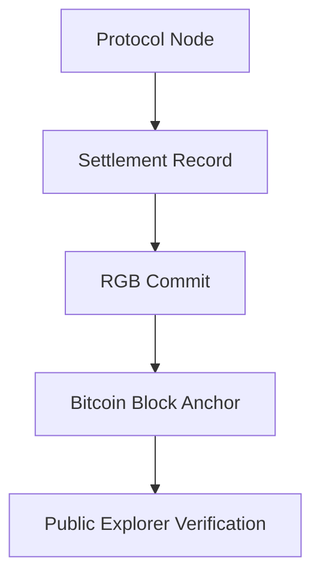

<!--
Source: https://phalynx.network/docs/settlement
Extracted: 2026-11-24 (America/New_York) from the public PhalynX Network site.
The site JS bundle was last-modified 2026-08-30 (HTTP Last-Modified on https://phalynx.network/assets/index-DQnlPCMO.js).
This file is a faithful Markdown conversion of the published page. Mermaid diagrams
were restored from the site source bundle. No protocol content was invented.
-->

# Settlement Protocol

How PhalynX converts verdicts into Bitcoin-denominated settlements that close justice loops with transparency and finality.

> **Financial Execution Layer**
>
> The Settlement Protocol is the financial execution layer of PhalynX. It handles everything that happens **after** the verdict: repayments, offsets, liquidity, investor returns, and long-term record anchoring. Settlement transforms a moral outcome into a cryptographic and economic one — **truth becomes payment.**

## Goals

| Objective | Description |
| --- | --- |
| **Finality** | Once a case is settled, no further claims or reversals are possible without a new verdict. |
| **Transparency** | All payment proofs are public, but payer identities remain pseudonymous. |
| **Neutrality** | No central escrow; all settlements occur peer-to-peer through Lightning or RGB. |
| **Automation** | Smart contracts manage token burns and release events automatically. |

## Key Components

| Component | Function |
| --- | --- |
| **Verdict Token Contract** | Holds RT/DPT/TRT token definitions and minting logic. |
| **Settlement Engine** | Monitors payments, triggers burns, updates balances. |
| **Lightning Escrow** | Multi-sig invoice system ensuring verifiable payments. |
| **Offset Router** | Applies cross-case debts before payouts. |
| **Investor Splitter** | Divides repayments between victims and investors. |

## Settlement Flow Overview



## Token Settlement Mechanics

### Restitution Token (RT)

* Burned gradually as BTC payments are received
* Each burn references the case hash + Lightning invoice TXID
* Remaining RT balance shows unpaid debt in real time

### Defense Preparedness (DPT) & Trauma Recovery (TRT)

* Redeemed directly by verified service providers
* Each redemption automatically triggers micro-settlements in BTC
* Providers receive instant payment via Lightning; victims receive service confirmation hash

> **Token Types**
>
> See the [Tokens](tokens.md) page for complete details on RT, DPT, and TRT token mechanics.

## Offsetting & Net Balances

When participants owe and are owed in multiple cases, the Offset Router computes their net justice balance:

```typescript
// Net Balance Calculation
// NetBalance = Σ RT_received - Σ RT_owed

interface CaseBalance {
  caseId: string;
  rtReceived: number;  // RT tokens received (sats)
  rtOwed: number;      // RT tokens owed (sats)
}

function calculateNetBalance(cases: CaseBalance[]): number {
  const totalReceived = cases.reduce((sum, c) => sum + c.rtReceived, 0);
  const totalOwed = cases.reduce((sum, c) => sum + c.rtOwed, 0);

  return totalReceived - totalOwed;
}

// Offset logic:
// - If NetBalance < 0: payouts withheld until debts cleared
// - If NetBalance > 0: surplus automatically released
// - Offsets signed by both parties' wallets (prevents unilateral adjustment)
```

## Payment Channels

### A) Direct Settlement

Defendant pays victim directly through a Lightning escrow invoice with three signers:

1. Defendant
2. Victim
3. Protocol Node

Funds release only when the protocol verifies a burn-proof transaction.

### B) Custodial Relays

If a defendant is unbanked or offline, payments can be routed through Reputation-verified relays (trusted third parties with ≥0.9 RI).

### C) Recurring Payments

Large settlements can be split into automated installments:

* BTC streamed via LSAT-based channels
* Each micro-payment burns proportional RT
* Default triggers RI penalty and bond seizure

## Investor Repayment

Investors fund operational costs (O = J + K + T) and liquidity for early victim payouts. During settlement, repayments are distributed as:

```typescript
// Investor Payout Formula
// P_i = (s_i / Σs_n) × (C_total - F_v)
//
// Where:
//   s_i = investor's stake fraction
//   F_v = victim's reserved share
//   C_total = total restitution paid

interface InvestorPayout {
  investorId: string;
  stake: number;
  payout: number;
}

function calculateInvestorPayouts(
  totalRestitution: number,
  victimShare: number,
  stakes: { id: string; amount: number }[]
): InvestorPayout[] {
  const investorPool = totalRestitution - victimShare;
  const totalStake = stakes.reduce((sum, s) => sum + s.amount, 0);

  return stakes.map(stake => ({
    investorId: stake.id,
    stake: stake.amount,
    payout: (stake.amount / totalStake) * investorPool
  }));
}

// Investor payouts occur immediately after each token burn event
```

> **Economics Integration**
>
> See the [Economics](economics.md) page for bond formulas and payout ordering details.

## Partial & Late Settlements

| Scenario | Action | Effect |
| --- | --- | --- |
| Partial Payment | Burn RT portion + reduce outstanding balance | Remaining debt visible in real time |
| No Payment (Default) | Bond forfeited → distributed to victim + investors | Defendant RI drops sharply |
| Late Payment | BTC owed remains fixed; fiat value may rise over time | Encourages timely repayment and social closure |

### Clarifying the Incentive

The restitution amount is defined in BTC at the time of verdict — that BTC amount does not change.

However:

* If Bitcoin's dollar value **increases**, the same BTC equals more in fiat terms. The defendant benefits by paying early before BTC appreciates further.
* If Bitcoin's dollar value **decreases**, the BTC amount still must be paid. The network treats this symmetrically — honesty and timeliness are enforced through reputation, not variable BTC totals.

> There are no interest charges or late fees — only real-world market pressure and social cost for delay.

## Settlement Anchoring

Every completed settlement publishes a Settlement Record on Bitcoin.

### Record Fields

* Case Hash
* TXID(s)
* Amount Paid (sats)
* Token IDs Burned
* Timestamp
* Juror Signature Aggregate
* SHA-256 Merkle proof



Users and auditors can verify a settlement independently by matching the case hash and burn transaction.

## Finalization

When 100% of RT supply for a case is burned:

1. The case transitions to **Settled State**
2. All involved parties' RI scores are updated
3. [Reputation](reputation.md) Ledger logs "Case Closed" event
4. Associated evidence keys are shredded by Knowledge Nodes (privacy release)

The final Merkle root of the case is appended to the **Global Settlement Registry** — the immutable archive of completed justice.

## Example Settlement Scenario

| Event | Details |
| --- | --- |
| Verdict | $100,000 equivalent in BTC |
| Defendant | Pays 20% upfront, 80% over 12 months |
| Investors | Hold 25% stake |
| BTC Trend | +10% appreciation during year |
| Result | Defendant repays same BTC amount; fiat value appears higher, motivating early completion |

**Outcome:** Defendant finishes repayment earlier to preserve bond and reputation. Victim and investors receive full BTC restitution — no interest, no inflation, no bureaucracy.

## Governance Integration

* **DAO Parameters:** can adjust maximum installment length, minimum Lightning channel size, and investor payout timing
* **Regional Nodes:** define legal compliance for fiat–BTC onramps
* **Audit Triggers:** automatic alerts if payment proofs fail verification within 24h
* **Insurance Layer (future):** pooled BTC reserve to cover verified defaults beyond bond value

> **Governance Parameters**
>
> See the [Governance](governance.md) page for details on DAO-controlled parameter adjustments and phase evolution.

## Transparency Dashboard

| Metric | Description | Sample Value |
| --- | --- | --- |
| Total Active Settlements | Cases still open | 1,342 |
| BTC Volume Settled | Cumulative | 892.5 BTC |
| Average Settlement Time | Mean (days) | 74 |
| Avg. Default Rate | Per 1,000 cases | 6.2 |
| Avg. Jury Confidence | Weighted % | 91.4% |

All metrics are recalculated hourly and published to the Settlement Explorer, with links to on-chain proofs.

## Summary

| Principle | Implementation |
| --- | --- |
| No Late Fees | BTC-denominated value fixed; fiat appreciation naturally encourages early repayment |
| No Central Bank | Peer-to-peer Lightning settlements |
| No Paperwork | Smart contract execution upon payment |
| Immutable Proof | Every burn anchored to Bitcoin |
| Self-Balancing System | Offsets + Reputation ensure fairness |
| Closure | Once settled, data anonymized, justice achieved |

> PhalynX Settlement is not about adding punishment — it's about bringing closure through transparent, market-aligned accountability where Bitcoin itself becomes the arbiter of time and value.
