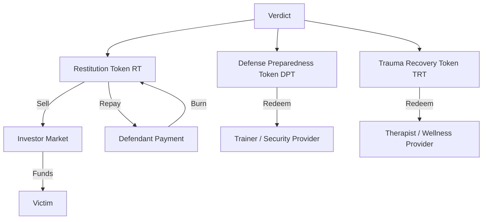
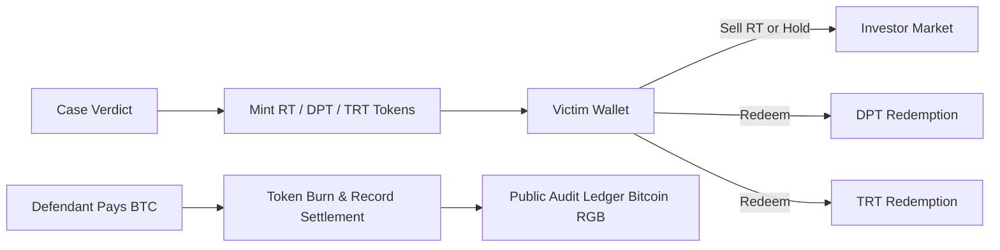

<!--
Source: https://phalynx.network/docs/tokens
Extracted: 2026-11-24 (America/New_York) from the public PhalynX Network site.
The site JS bundle was last-modified 2026-08-30 (HTTP Last-Modified on https://phalynx.network/assets/index-DQnlPCMO.js).
This file is a faithful Markdown conversion of the published page. Mermaid diagrams
were restored from the site source bundle. No protocol content was invented.
-->

# Compensation & Recovery Tokens

Restitution (RT), Defense Preparedness (DPT), and Trauma Recovery (TRT) tokens — denominated in Bitcoin for long-term alignment and self-reinforcing justice economics.

> **Bitcoin-Denominated Justice**
>
> All verdict tokens are issued through the RGB layer on Bitcoin, ensuring fixed supply, transparent accounting, and appreciation potential that incentivizes timely repayment.

## Verdict Token Set

All verdicts mint a **Verdict Token Set**, consisting of:

| Token | Purpose | Allocation |
| --- | --- | --- |
| RT | Restitution Token — Primary claim for monetary compensation | 70-90% of C |
| DPT | Defense Preparedness Token — Funds physical safety and training | 5-10% of C |
| TRT | Trauma Recovery Token — Funds emotional and psychological recovery | 5% of C |



## Restitution Token (RT)

**Ticker:** `RT-<case_id>`
**Denomination:** Bitcoin (satoshis)

### Behavior

* Minted at verdict with face value equal to the jury's awarded claim (**C**)
* Represents the debt obligation of the guilty party
* Burned automatically as payments are received (Lightning invoice or on-chain)
* **Transferable** — victims may sell RTs to investors or marketplaces to receive early liquidity

### Why Bitcoin Denomination

PhalynX eliminates the need for late-payment penalties or interest calculations. Because RTs are denominated in BTC, and Bitcoin's long-term trend is upward, the *real cost of delay* rises automatically.

> **Natural Timeliness Incentive**
>
> * Paying late means paying more BTC as its purchasing power rises
> * Paying early preserves value for the debtor
> * No centralized enforcement or interest mechanism is needed

### Repayment & Offsetting

If a victim is also a debtor in another case, their RT compensation automatically offsets their owed tokens first before payout:

```typescript
// Net balance calculation
interface ParticipantBalance {
  rtReceived: number;  // Total RT earned as victim
  rtOwed: number;      // Total RT owed as defendant
}

function calculateNetBalance(balance: ParticipantBalance): number {
  return balance.rtReceived - balance.rtOwed;
}

// If negative, payouts are held until obligations are cleared
// This ensures system-wide net restitution integrity
```

This ensures system-wide **net restitution integrity** — debts are cleared before rewards are realized. Integrations with employers or payment systems allow voluntary paycheck deductions or escrow mechanisms to settle RTs.

### Early Liquidity via Market Sale

Victims can tokenize and trade their RTs:

* Sell partially or fully to investors for immediate BTC
* Market determines discount based on defendant's repayment reputation (RIa)
* Investors assume risk and receive repayment flows directly from burn events

> This creates a **secondary restitution market** — transforming justice from static judgment into a liquid, incentive-driven economy.

## Defense Preparedness Token (DPT)

**Purpose:** Fund the victim's empowerment and physical protection against future threats.

### Coverage

The DPT can be redeemed for:

* **Training** — self-defense, martial arts, firearms proficiency, de-escalation courses
* **Equipment** — personal defense gear, concealed-carry tools, alarms, cameras, security systems
* **Security Services** — temporary or long-term private guard contracts, patrol coverage, risk assessment consults

DPTs are **non-transferable** (soulbound-style) but **redeemable by certified vendors**.

### Redemption Flow


Each redemption is verified by a Knowledge Node that ensures authenticity of service or goods. Providers are paid in BTC once proof is verified and logged.

### DPT Tokenomics

| Parameter | Default |
| --- | --- |
| DPT Allocation | 5-10% of total restitution C |
| Expiration | 12 months |
| Fungibility | Non-transferable, merchant-redeemable |
| Verification | Service receipt + signature of Knowledge Node |
| Reputational Impact | Victim gains "Resilience RI" points after use |

## Trauma Recovery Token (TRT)

**Purpose:** Fund emotional and psychological recovery.

### Redemption Options

* Licensed therapists and trauma counselors
* Mental health retreats or rehabilitation programs
* Relocation assistance or identity protection
* Spa, wellness, and decompression programs (approved vendors)
* Short therapeutic vacations to aid healing

Like DPTs, TRT is **non-transferable**, redeemable only by certified providers.

### TRT Tokenomics

| Parameter | Default |
| --- | --- |
| TRT Allocation | 5% of total restitution C |
| Expiration | 18 months |
| Verification | Invoice + provider credential hash |
| Fund Flow | Provider paid via BTC after proof validation |
| Reputation | Victim gains "Recovery RI" points upon completion |

## Token Life Cycle



## Economic Feedback & Incentives

| Actor | Incentive | Behavior Encouraged |
| --- | --- | --- |
| Defendant | Rising BTC cost of delay | Pay debts promptly |
| Victim | Early liquidity + empowerment funds | Rebuild safety & peace of mind |
| Investors | ROI from discounted RT purchases | Fund justice ecosystem |
| Providers | New income stream in BTC | Deliver real-world services tied to verified victims |
| Network | Circulation of verifiable outcomes | Builds trust, data, and reputational transparency |

## Settlement Mechanics

Each RT, DPT, TRT token is an RGB contract with:

```typescript
// RGB Token Contract Structure
interface VerdictToken {
  issuer: string;           // Jury / Micro-DAO contract address
  assetMetadata: {
    caseHash: string;       // SHA-256 hash of case data
    category: 'RT' | 'DPT' | 'TRT';
    amount: number;         // Amount in satoshis
    expiration: number;     // Unix timestamp (or null for RT)
  };
  redemptionProof?: {
    provider: string;       // Certified provider ID
    serviceHash: string;    // Hash of service receipt
    timestamp: number;
    knNodeSignature: string;
  };
}

// Payment triggers auto-burn events logged by protocol nodes
async function burnToken(
  tokenId: string,
  paymentProof: BitcoinTx
): Promise<BurnEvent> {
  // Verify payment on Bitcoin main chain
  // Burn corresponding token amount
  // Anchor settlement to RGB layer
  // Emit BurnEvent for audit ledger
}
```

Payments made through Lightning or on-chain trigger auto-burn events logged by protocol nodes.

## Offsetting and Debt Netting

If a participant is both victim and debtor, the system automatically offsets their balances:

```typescript
// Debt netting formula
const NetBalance = RT_received - RT_owed;

// Implementation
interface DebtNetting {
  participantId: string;
  rtReceived: number;   // Total RT earned as victim
  rtOwed: number;       // Total RT owed as defendant
  netBalance: number;   // Calculated net position
  payoutEligible: boolean;
}

function calculateDebtNetting(
  received: number,
  owed: number
): DebtNetting['netBalance'] {
  return received - owed;
}

// If negative, payouts are held until obligations are cleared
// This ensures the network maintains a closed restitution economy
// Everyone's balance across time trends toward moral equilibrium
```

> **Closed Restitution Economy**
>
> The network maintains a closed restitution economy — everyone's balance across time trends toward moral equilibrium. Debts must be cleared before new payouts are released.

## Rationale for Bitcoin Denomination

Bitcoin provides:

* **Inflation resistance:** compensation doesn't decay over time
* **Timeliness incentive:** as BTC appreciates, late payments cost more in real terms — no need for artificial interest or penalty fees
* **Universal settlement:** cross-border, censorship-resistant, instantly verifiable
* **Liquidity:** victims and investors can interact with the global Bitcoin market without intermediaries

> **Self-Balancing Justice Economy**
>
> PhalynX transforms justice into a self-balancing economy — where truth mints value, harm mints accountability, and Bitcoin enforces both with time as its ally.
