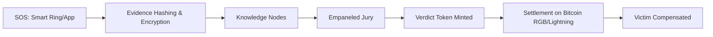
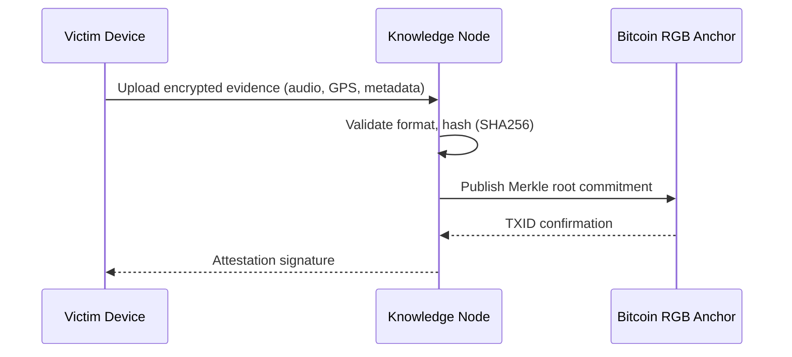

<!--
Source: https://phalynx.network/docs/whitepaper
Extracted: 2026-11-24 (America/New_York) from the public PhalynX Network site.
The site JS bundle was last-modified 2026-08-30 (HTTP Last-Modified on https://phalynx.network/assets/index-DQnlPCMO.js).
This file is a faithful Markdown conversion of the published page. Mermaid diagrams
were restored from the site source bundle. No protocol content was invented.
-->

# PhalynX Network Whitepaper v1

A Decentralized Shield Wall for Truth and Justice

By Chad Elwartowski, Founder — First Seasteader

## Abstract

PhalynX Network introduces a protocol for decentralized justice — a digital framework that anchors evidence, verifies truth, and enforces restitution through peer adjudication and Bitcoin-backed settlements. It redefines the relationship between crime, accountability, and compensation by ensuring that *every act of harm carries a measurable and enforceable cost* without reliance on state institutions.

## 1. Motivation: The Failure of Centralized Justice

Traditional legal systems evolved around geography and bureaucracy, not data. They are **slow**, **expensive**, and often **disconnected from victims' needs**. Even in democratic nations, the centralization of force enables arbitrary lawmaking where "society" — an abstraction — becomes the supposed victim.

PhalynX rejects that abstraction. In our model, *justice begins with a victim* — a provable harm — and ends with restitution directly to that victim, not fines to governments or institutions.

## 2. Foundational Principles

1. **Victim Requirement** – no claim exists without a harmed party.
2. **Peer Adjudication** – random, reputation-weighted juries deliver verdicts transparently.
3. **Economic Accountability** – restitution is denominated in Bitcoin; truth becomes enforceable value.
4. **Evidence Anchoring** – digital proof (audio, GPS, video) is hashed, timestamped, and attested.
5. **Privacy by Design** – encryption and threshold decryption ensure selective access.
6. **Reputation Is Currency** – every actor's history affects their required bond and future credibility.

## 3. System Overview

The PhalynX Network connects four primary domains:

| Layer | Purpose |
| --- | --- |
| **Evidence** | Capture, hash, and anchor data on IPFS + Bitcoin timestamp. |
| **Jury** | Empaneled peers verify facts and vote on guilt. |
| **Settlement** | Verdicts create Bitcoin-denominated tokens representing restitution debt. |
| **Governance** | Parameters, upgrades, and dispute appeals managed by bonded stakeholders. |



## 4. Architecture & Actors

| Role | Description |
| --- | --- |
| **Victim (V)** | Initiates case; posts Victim Bond (VB). |
| **Accused (A)** | Defends claim; posts Defendant Bond (DB). |
| **Juror (J)** | Randomly selected peers; bonded; commit-reveal vote. |
| **Knowledge Node (K)** | Verifies evidence integrity; provides attestations. |
| **Protocol Node (P)** | Maintains case state, jury selection, and reputation ledger. |
| **Collector (C)** | External enforcement; integrates with credit and judgment systems. |

## 5. Evidence Layer

Evidence is not stored on-chain but anchored via hash trees and time-stamped commitments. Each upload yields a Merkle root committed to Bitcoin through RGB smart contracts or OP\_RETURN anchors.



* **Encryption:** AES-256 symmetric; keys split among jury quorum.
* **Verification:** multi-node attestation prevents single-node tampering.

## 6. Jury Protocol

* **Panel Size:** Default 7 jurors (odd number).
* **Selection:** random weighted by reputation and stake.
* **Voting:** commit-reveal to prevent collusion.
* **Incentives:** jurors are paid from case bonds; dishonest votes are slashed.


## 7. Bond Mechanics

Each case requires two economic stakes:

* **Victim Bond (VB)** – prevents frivolous claims.
* **Defendant Bond (DB)** – ensures appearance and payment ability.

### Bond Formulas

```
VB = clamp(Vb_min, Vb_max, α × ClaimValue × f(RI))

f(RI) = RI_high / max(RI, RI_floor)

// Lower reputation → smaller victim bond
// (encourages reporting repeat offenders).
```

Both VB and DB pay jurors and knowledge nodes.

### Payout Order

> **If Guilty**
>
> 1. DB covers restitution.
> 2. VB refunded + yield.
> 3. Verdict token minted for any remainder.

> **If Not Guilty**
>
> 1. VB covers juror/knowledge costs.
> 2. DB refunded.
> 3. RI of victim decreases slightly (false claim penalty).

## 8. Verdict Token & Bitcoin Integration

Each verdict mints a Bitcoin-denominated token (VToken) on RGB. This token represents enforceable restitution debt, transferable or burnable upon payment.

| State | Meaning |
| --- | --- |
| **UNPAID** | Debt outstanding. |
| **PAID** | Burn transaction executed on Bitcoin L2. |
| **INDEXED** | Token added to collective fund (optional liquidity pool). |

* **Anchoring:** RGB contracts store case hash, verdict ID, and payout address.
* **Settlement:** guilty party pays Lightning invoice → burn proof triggers payout to victim.
* **Transparency:** proof-of-payment available without exposing identities.


## 9. Reputation Layer

Each actor has a Reputation Index (RI) ∈ [0,1].

```
RI_new = β × RI_old + (1 - β) × OutcomeScore
```

* Jurors gain or lose RI based on alignment with consensus.
* Accused gain RI when exonerated; lose RI when guilty.
* Victims gain RI when claims validated; lose RI when dismissed.
* RI influences bond sizing and jury eligibility.

## 10. Governance Model

The protocol evolves in phases:

| Phase | Control | Description |
| --- | --- | --- |
| **0: Founding** | Admin multisig | Development, early pilots. |
| **1: Parameterized** | Stakeholders | Bonds, RI decay, quorum adjustable by vote. |
| **2: Decentralized** | On-chain governance | Parameter & upgrade proposals via VToken holders. |

All governance actions are subject to **Proof-of-Victim**: only those with validated participation history can propose parameter changes.

## 11. Security & Privacy

* **Encryption:** AES-256 evidence, ECC-based key splits for juror quorum.
* **Auditing:** deterministic logs signed by Knowledge Nodes.
* **Sybil resistance:** stake-weighted + reputation-limited juror selection.
* **Anonymity:** zkProofs for verdict publication (future phase).
* **Resilience:** open-source clients, redundant nodes, off-grid deployable (mesh-friendly).

## 12. Implementation Phases

| Phase | Milestone |
| --- | --- |
| **α (Pilot)** | Próspera (Roatán) — limited cohort, centralized coordination. |
| **β (Protocol v1)** | Full RGB anchoring, juror bonds, and Lightning settlement. |
| **γ (Decentralized)** | On-chain governance + open node registration. |

## 13. Future Extensions

1. **Drone Evidence Oracles** – autonomous recording for verification bounties.
2. **Responder Integration** – dispatch proof with bonded responders.
3. **Insurance Pools** – collective risk coverage for honest participants.
4. **AI Adjudication Assistance** – large models providing summaries and fraud detection.
5. **Credit Bridge** – optional reporting of unpaid debts to real-world credit systems.

## 14. Conclusion

PhalynX establishes a universal, decentralized substrate for justice — one that treats truth as collateral and restitution as currency.

Where the state once claimed monopoly on enforcement, PhalynX replaces compulsion with consensus, bonds, and Bitcoin settlement. Its design allows human dignity and technological accountability to coexist.

Chad Elwartowski
Founder — PhalynX Network
First Seasteader

## Appendix A — Core Parameters

| Symbol | Meaning | Default |
| --- | --- | --- |
| `α` | Bond ratio constant | 0.1 |
| `β` | Reputation damping | 0.8 |
| `Vb_min` | Minimum Victim Bond | $50 |
| `Vb_max` | Maximum Victim Bond | $5,000 |
| `RI_floor` | Minimum RI for scaling | 0.1 |
| `JurySize` | Default jurors per case | 7 |

## Appendix B — Data Schema

```json
{
  "case_id": "uuid",
  "victim_id": "uuid",
  "accused_id": "uuid",
  "claim_value_sats": 500000,
  "vb_amount_sats": 10000,
  "db_amount_sats": 20000,
  "evidence_roots": ["sha256:..."],
  "verdict": {
    "guilty": true,
    "restitution_sats": 500000,
    "rgb_txid": "..."
  }
}
```

## Appendix C — Glossary

| Term | Definition |
| --- | --- |
| **Bond** | Stake locked to ensure participation honesty. |
| **Verdict Token** | Bitcoin-denominated restitution debt token. |
| **Knowledge Node** | Node verifying evidence authenticity. |
| **Proof-of-Victim** | Requirement that all governance begins with harm. |
| **RGB** | Smart contract layer for Bitcoin enabling tokenized assets. |
| **Lightning Network** | Layer-2 Bitcoin payment system for instant settlements. |
